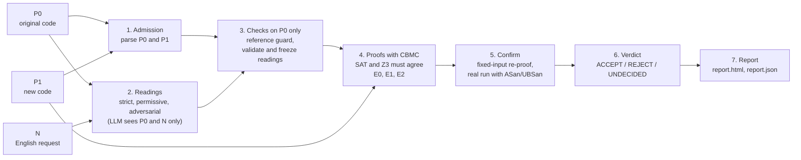
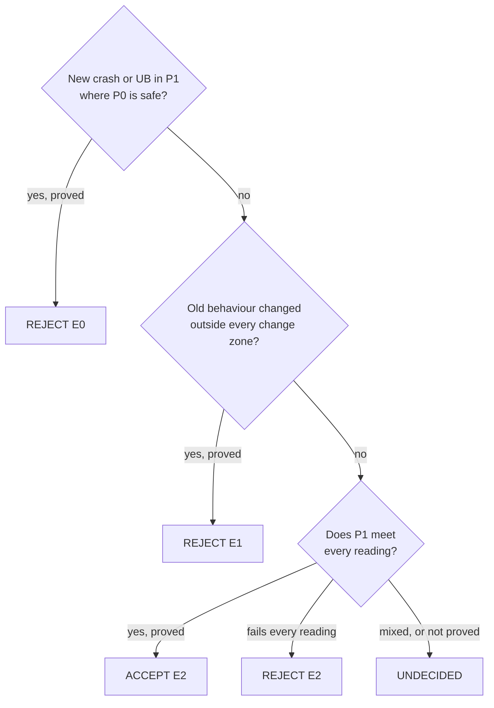

# Approach-2: Verdicts with Evidence (VWE)

VWE checks a fix that an AI assistant made to a C function. It takes three inputs:

* **P0**, the original buggy function,
* **N**, the change request in plain English,
* **P1**, the new version to be judged.

It answers **ACCEPT**, **REJECT** or **UNDECIDED** and saves the evidence behind the answer: a proof
from CBMC, or a concrete input that breaks P1 and that we have actually run.

* Report: [docs/report/VWE_report.pdf](docs/report/VWE_report.pdf)
* Slides: [docs/report/VWE_slides.pptx](docs/report/VWE_slides.pptx)
* Live demo guide: [docs/LIVE_DEMO.md](docs/LIVE_DEMO.md)

## How it works



How the verdict is decided:



In words:

1. **Admission.** Parse P0 and P1, in the normal build and with `__SYNTHESIS__` defined. The
   signature must be the same, and the code must use only C we can model.
2. **Readings.** Write down several possible meanings of N (strict, permissive, adversarial). They
   come from a JSON file or from an LLM that sees only P0 and N. No LLM ever sees P1.
3. **Checks on P0 only.** Find where P0 itself is safe (the reference guard). Check each reading
   (V-G, V-1 to V-4), drop the bad ones, then freeze the rest with a hash.
4. **Proofs.** Generate a C harness that runs P0 and P1 side by side on symbolic inputs. CBMC
   checks it with both SAT and Z3, and they must agree.
   * E0: P1 adds no crash or undefined behaviour where P0 was safe.
   * E1: outside every change zone, P1 behaves exactly like P0.
   * E2: P1 meets every reading.
5. **Confirmation.** A failing input is proved again with the inputs fixed, then both programs are
   compiled with AddressSanitizer and UBSan and run on it for real.
6. **Verdict.** A fixed rule table. Anything not proved becomes UNDECIDED.
7. **Report.** `report.json` and `report.html` with every proof and witness.

## Results

| Experiment | Result | Details |
|---|---|---|
| Our 20 golden example candidates | 20/20 match the expected verdict | [checkpoint](evaluation/results/checkpoints/2026-11-23-t22/README.md) |
| Live demo cases | 9/9 match | [checkpoint](evaluation/results/checkpoints/2026-11-23-t22/README.md) |
| 181 HLSCheck (Approach-1) cases | 125 decided, all 125 agree with the label, 0 wrong | [summary](evaluation/results/eval_project3/summary.md) |
| 89 Chrysalis-HLS bug candidates | 1 decided, 0 wrong (a tests-only check made 41 wrong) | [summary](evaluation/results/eval/summary.md) |
| Automated test suite | 436 passed, 1 skipped (ESBMC test, Linux only) | `make test` |

VWE has not made a wrong decision in any of these. The price is that it often says UNDECIDED,
mostly because of SAT timeouts on multiplication-heavy code and bugs that disappear at the small
input sizes we check. All results are bounded: they hold for the declared input ranges and sizes.

## Folder layout

| Folder | What is in it |
|---|---|
| [`vwe/`](vwe/README.md) | the source code, one file per stage |
| [`scripts/`](scripts/README.md) | demo, benchmark and evaluation commands |
| [`examples/`](examples/README.md) | the seven hand-made example tasks used in the demo |
| [`evaluation/`](evaluation/README.md) | benchmarks, all saved results, one sample run, tool experiments |
| [`tests/`](tests/README.md) | automatic tests |
| [`docs/`](docs/README.md) | reports, slides, demo guide, diagrams and build notes |
| [`config/`](config/README.md), [`schemas/`](schemas/README.md) | settings and JSON formats |
| [`docker/`](docker/README.md), [`tools/`](tools/README.md) | tool installation |

## Setup

Needs Python 3.10 or newer, CBMC 6.11.0 (with Z3) and Clang. On Linux,
`bash tools/install_tools.sh` installs the pinned tools.

Run everything from the VWE folder (the top of the `approach-2-vwe` branch, or `approach-2-vwe/` on `main`).

```sh
python3 -m venv .venv
source .venv/bin/activate
pip install -e .
cbmc --version          # 6.11.0
```

## Running it

```sh
# one candidate, every stage printed as it runs (about 20 seconds)
python scripts/demo_steps.py --task ex1_saturate --candidate v3      # REJECT E1
python scripts/demo_steps.py --task ex1_saturate --candidate v1      # ACCEPT E2
python scripts/demo_steps.py --task ex2_argmax   --candidate v2      # REJECT E1

# the same through the normal command line
python -m vwe verify examples/tasks/ex2_argmax --candidate v2

make demo        # nine demo cases, writes runs/demo/index.html
make golden      # the 20 golden candidates
make test        # all automatic tests (about 10 minutes)
make portal      # demo web page runs/index.html from your latest runs
make demo-reset  # clear old demo outputs before a live demo
```

Each run creates a new folder `runs/demo-steps/<task>/<candidate>/<run id>/` (or
`runs/<task>/<candidate>/<run id>/` for `python -m vwe verify`). The last line it prints is the
path of `report.html`. A complete example of this folder, with every file explained, is in
[evaluation/sample_runs/](evaluation/sample_runs/README.md).

To get readings from live LLMs instead of the handwritten ones, put a Groq key in
`config/secrets/groq.key` and add `--auto groq`.

## Limits

* Results hold only for the declared input ranges and buffer sizes.
* Only a subset of C is supported (no inline assembly, unknown library calls or new globals).
* An ACCEPT assumes our list of readings fairly covers what N means.
* ESBMC is used only to cancel an ACCEPT and is not installed on macOS here.

Rules we kept to while writing the code are in [CONTRIBUTING.md](CONTRIBUTING.md).
