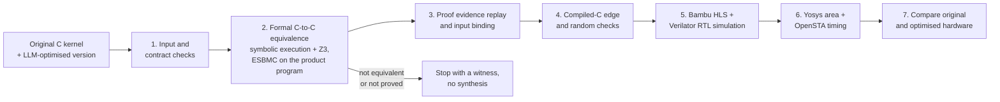
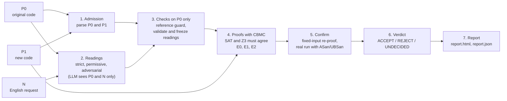
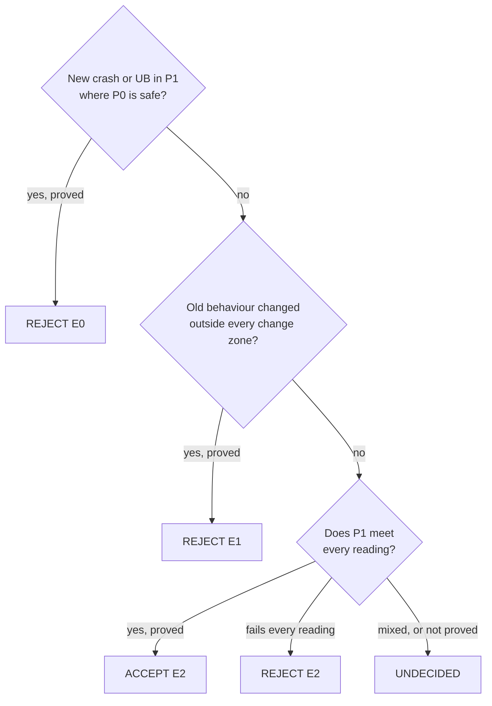

# Formal Verification of LLM-Optimised and LLM-Repaired C Code for High-Level Synthesis

Course project for **C-Based VLSI Design (CS5291)**, IIT Guwahati, under Dr. Chandan Karfa.

Team: Dhruvkumar R Pansuriya (230101071), Aryan Kaushik (230101018), Lasya Madhu Sundar (230101058).

When a language model rewrites C code, someone has to decide whether the new code is right. We
worked on this in two ways. Each approach has its own folder with its code, tests, benchmarks,
results, report and slides. The same code is also on its own branch,
[`approach-1-hlscheck`](https://github.com/DhruvPansuriya/C-Based-VLSI-Design-Course-Project/tree/approach-1-hlscheck) and [`approach-2-vwe`](https://github.com/DhruvPansuriya/C-Based-VLSI-Design-Course-Project/tree/approach-2-vwe).

| Folder | Approach | Question it answers |
|---|---|---|
| [`approach-1-hlscheck/`](approach-1-hlscheck/README.md) | **HLSCheck** | Is the optimised kernel equivalent to the original, and is its hardware better? |
| [`approach-2-vwe/`](approach-2-vwe/README.md) | **Verdicts with Evidence (VWE)** | Does the fixed function do what the English request asked, and nothing else? |

---

## Approach-1: HLSCheck

An LLM rewrites a C kernel to make better hardware, for example by reordering loops. HLSCheck
answers two separate questions:

1. **Is it still correct?** It proves the rewrite is equivalent to the original. Our symbolic
   executor and Z3 prove relations between parts of the two programs, and ESBMC checks whatever
   is left in a combined "product" program. Every answer is checked again with compiled-C tests.
2. **Is the hardware better?** Only proved-equivalent code goes on to high-level synthesis
   (Bambu), RTL simulation (Verilator), area (Yosys) and timing (OpenSTA), and we compare it with
   the original.



**Main results**

* 50 curated original/rewrite pairs: all 50 proved equivalent, and all 50 injected faults were
  rejected.
* Hardware: area x latency improved for 22 pairs, got worse for 25 and was unchanged for 3. A
  correct rewrite is not always a better one.

**Run it** (after the setup in [SETUP.md](approach-1-hlscheck/SETUP.md)):

```sh
cd approach-1-hlscheck
python run_demo.py matmul.cpp matmul_opti.cpp --function kernel    # equivalent: goes on to HLS
python run_demo.py matmul.cpp matmul_wrong.cpp --function kernel   # wrong: stops with a witness
```

**Where things are:** checker code in `hlscheck/`, benchmarks in `benchmarks/`, all results in
`results/` (overview in [RESULTS.md](approach-1-hlscheck/RESULTS.md)), experiment plans and prompts
in `experiments/`, tests in `tests/`.

Report and slides: [approach-1-hlscheck/report/](approach-1-hlscheck/report/README.md).

---

## Approach-2: Verdicts with Evidence (VWE)

Here the LLM is asked to **fix** a function, given an English request. VWE takes the original
code P0, the request N and the new code P1, and answers ACCEPT, REJECT or UNDECIDED, always with
evidence.

* It keeps several readings of the request instead of one fixed spec, because English can be
  ambiguous.
* The LLM that writes the readings sees only P0 and N, never P1.
* CBMC, with both SAT and Z3, proves three things: P1 adds no new crash (E0), P1 changes nothing
  outside the requested change (E1), and P1 meets every reading (E2).
* Any failing input is proved again with the inputs fixed and then run for real with
  AddressSanitizer and UBSan before VWE rejects.





**Main results**

* 20/20 golden examples and 9/9 demo cases match.
* On 181 HLSCheck cases, VWE decided 125 and agreed with the label on all 125.
* On 89 Chrysalis-HLS bug candidates it made no wrong decision, but decided only one. A
  tests-only check made 41 wrong decisions.

**Run it:**

```sh
cd approach-2-vwe
python3 -m venv .venv && source .venv/bin/activate && pip install -e .
python scripts/demo_steps.py --task ex1_saturate --candidate v3    # REJECT E1
python scripts/demo_steps.py --task ex1_saturate --candidate v1    # ACCEPT E2
make test                                                          # all tests
```

**Where things are:** code in `vwe/`, example tasks in `examples/`, benchmarks, saved results and
one sample run in `evaluation/`, tests in `tests/`, live demo guide in
[docs/LIVE_DEMO.md](approach-2-vwe/docs/LIVE_DEMO.md).

Report and slides: [approach-2-vwe/docs/report/](approach-2-vwe/docs/report/README.md).

---

## How the two connect

HLSCheck asks "is the rewrite equivalent?". VWE asks the harder question "is the change the one
that was requested, and only that?". We ran VWE on HLSCheck's 181 cases as a second, independent
check. The commands are in [approach-2-vwe/evaluation/](approach-2-vwe/evaluation/README.md).

## Tools

CBMC 6.11 with Z3, ESBMC, Clang with AddressSanitizer and UBSan, pycparser, Bambu, Verilator,
Yosys and OpenSTA (Nangate45), plus LLMs through Groq (gpt-oss-120b and Qwen).
