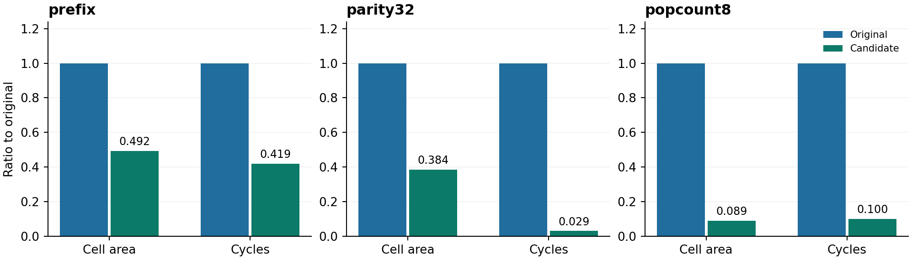
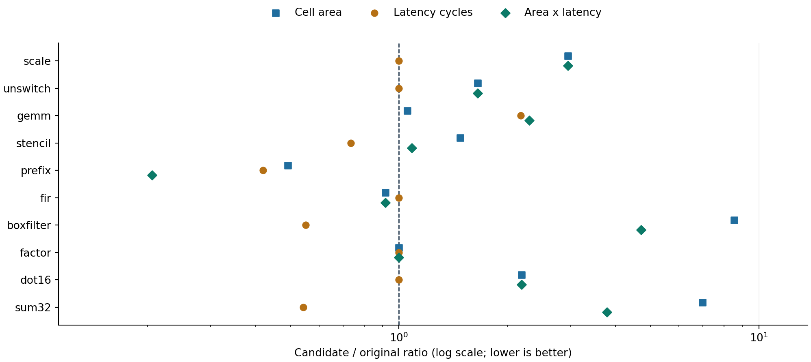
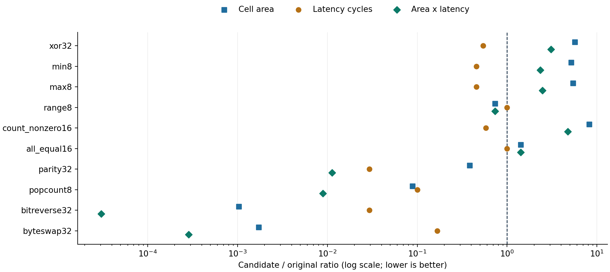
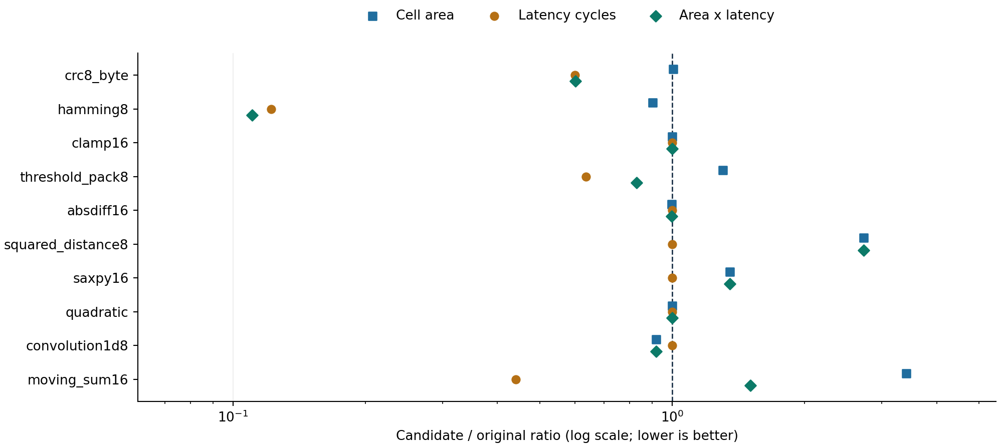
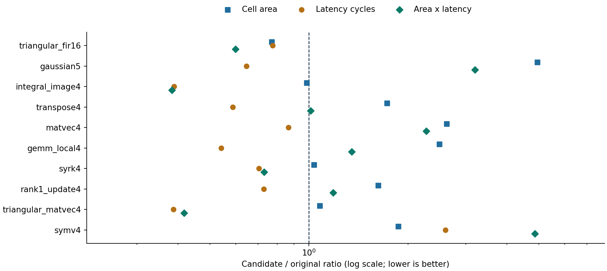
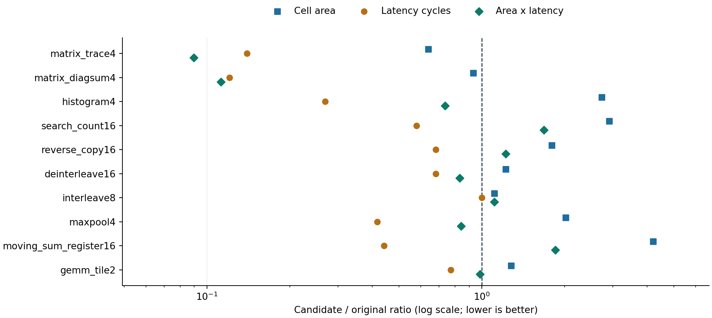

# Project 3 submission report

## Formal Equivalence Checking of LLM-Optimized HLS Code

CS5291 | Project 3 | Expanded measured study | 22 November 2026

### Abstract

The expanded submission records 50 original/candidate C pairs and 100 real synthesized implementations. Forty educational additions and two feedback-driven follow-ups extend the initial eight-pair study with reductions, bit manipulation, filters, images, linear algebra and data movement. The custom checker proves every candidate equivalent within its supported unsigned C domain, and rejects every deliberately seeded faulty variant. Exact original/optimized sources, transformation explanations, input hashes, SMT queries, native replay and hardware logs accompany each pair.

The hardware experiment uses Bambu, Verilator, Yosys and OpenSTA with common settings. 22 candidates improve mapped area x latency, 25 regress it and 3 are unchanged within a 0.1% classification tolerance. Independently, 14 reduce area and 34 reduce cycle latency. These are descriptive results on selected related educational kernels, not a distributional LLM success rate.

A separate zero-API-charge local Qwen experiment records forty raw attempts: 28 equivalent, eight non-equivalent, two undefined-C and two unresolved. Nine verified changed outputs receive hardware measurements. An 80-case subtle-edit suite and eight type-preserving public-suite leaf functions strengthen the correctness evaluation; Sections 9-12 report these distinct cohorts.



Prefix reuse saves 50.8% area and 58.1% cycles. XOR-fold parity saves 61.6% area and changes latency from 34 to 1 cycles. Byte SWAR population count saves 91.1% area. The bit-permutation cases map mostly to wires and minimal interface logic; their extreme ratios are interpreted separately from arithmetic kernels.

### What was built

The original implementation combines a restricted-C symbolic interpreter, Z3 modular arithmetic, component lemmas and an attributed ESBMC adapter. The default checker now uses certified relational summaries and counterexample refinement: symbolic proofs simplify the C product verified by ESBMC. Sections 13-14 evaluate that proof-level combination separately. Existing ideas and upstream engines are credited; no first-ever verification algorithm is claimed.

All proofs are conditional on the supported C semantics and nonaliasing arrays. Hardware values are Nangate45 typical pre-layout estimates, not routed timing or FPGA resource counts.

## 1. Scope and workload accounting

The study unit is one original/candidate pair. There are 50 pairs, 100 hardware implementations and 47 distinct original C ASTs after comment/format removal. gemm_local4 and gemm_tile2 reuse the original GEMM reference; moving_sum_register16 reuses the moving-window reference. Min/max, population-count, reduction and data-movement variants also share algorithmic ideas. The study therefore does not claim 50 independent applications or unmodified public-suite benchmarks.

| Recorded group | Pairs |
| --- | --- |
| initial cohort | 8 |
| reduction | 3 |
| comparison reduction | 3 |
| predicate reduction | 4 |
| bit manipulation | 6 |
| elementwise | 4 |
| arithmetic | 2 |
| filter | 3 |
| image | 3 |
| data movement | 4 |
| linear algebra | 8 |
| feedback variants | 2 |

The original GEMM and stencil references are reduced uint32_t adaptations of downloaded MachSuite algorithms. The second GEMM candidate uses the same adapted reference and preserves its BSD-style license. Remaining additions are independently authored educational implementations selected for the explicit checker subset. Types and dimensions are identical within each pair; upstream floating/signed semantics are not claimed.

### Recorded LLM work

The Codex assistant authored the source rewrites in this conversation. The generation record states the preservation constraints and exposes all actual C artifacts. No unobserved model ID, temperature, response identifier or token count is invented. tools/expand_benchmarks.py materializes the forty additional source definitions; it is not an external LLM sampling experiment.

Every per-pair dossier in experiments/optimizations includes the exact original and optimized C, the transformation, expected hardware motivation, source hashes, proof and query links, negative control, actual metrics and the objective-specific acceptance decision.

## 2. Checker semantics and compositional proofs

```text
Common initial inputs + reachable final path pair
+ different return / final parameter-array contents
    SAT -> concrete mismatch
    UNSAT -> equivalence in the modeled domain
```

The custom interpreter models uint32_t arithmetic as 32-bit modular bit-vectors, concrete signed loop counters, fixed-size one-dimensional arrays, symbolic predicates and early returns. Supported loops are expanded completely; symbolic indices, unrestricted pointers, calls, globals, persistent state, floating point and general symbolic signed arithmetic are rejected. All arrays are valid and disjoint; every final parameter-array element is observable.

Both source programs must be free of modeled undefined behavior throughout the admitted input domain. Zero divisors, invalid shifts and out-of-bounds accesses are separate outcomes. Budget exhaustion and solver unknown do not become equivalence claims. This is a stricter contract than source-defined-subset compiler refinement.

### New proof acceleration in the expanded study

Z3 first normalizes modular polynomial output differences. When an additive expression separates into terms with disjoint symbolic-variable dependencies, the checker tries unconditional zero-component queries. Only an UNSAT component query permits removing that component. SAT, timeout or unknown components remain in the final mismatch query. Independence is a grouping heuristic; acceptance rests on exact additive decomposition and universally proved-zero components.

The eight-byte Hamming reduction initially reached a 30 s monolithic timeout. Its source, query, hashes and unknown verdict remain under experiments/attempts/hamming8_monolithic. The enhanced checker proves eight byte-level component lemmas and then the remaining aggregate query. Every accepted lemma is exported; the final SMT file identifies its dependencies. A final simplified query alone is not the full evidence chain.

The historical ESBMC/Z3 adapter and PAST experiments remain reproducible. The new default integrates symbolic region proofs with residual C verification and refinement; see Sections 13-14. Bounds, safety and unwinding checks remain enabled. Upstream engines are attributed.

## 3. Experimental protocol and validation

| Stage | Recorded method |
| --- | --- |
| Formal checking | 50 optimized pairs + 50 seeded controls; complete supported execution, 30 s main solver budget |
| SMT replay | 50 unrestricted UNSAT main queries, 8 unrestricted component queries, and 50 witness-pinned SAT queries |
| Compiled C | 13,200 original/candidate test trials; 50 concrete witnesses reproduced with exact output agreement |
| RTL simulation | 1,600 calls; sixteen per hardware implementation |
| Hardware comparison | Identical types, dimensions, HLS setup, library and 10 ns clock within each pair |

Each native pair receives eight directed patterns and 256 deterministic xorshift trials, seed 0x5291abcd. These validate executions and witness reporting; testing is not the universal equivalence argument. The unit suite has 92 passing tests on the measured machine, including polynomial/component-proof regressions and real external-verifier checks.

The original eight faults include structural/arithmetic mutations. The forty-two additional controls deliberately flip one output bit after computing the candidate result. They validate rejection and replay but are not a challenging independent mutation benchmark, naturally occurring LLM mistakes, or an estimate of an LLM bug rate.

### Hardware settings

Bambu 2026.11 revision 6407a63da948c1b2223d63a9e91891a5628fe174-dev/panda, Clang 16, BAMBU-BALANCED-MP (-O2), seed 0, target Nangate45 typical at 10 ns. Verilator 5.020 measures function cycles; Yosys 0.36 maps cells; OpenSTA 2.0.18 performs max-path timing. Source hashes and a configuration fingerprint guard cached results.

The library is typical 1.1 V, 25 C. Timing uses ideal clocks, zero IO delays, 50 ps input transitions, 10 fF output loads and no extracted wires. Delay is 10 ns minus worst max-path slack. Reported unconstrained endpoints must match constant outputs in the mapped netlist. Cell area includes mapped local memory, excludes external memory/host resources and does not include physical placement/routing overhead.

## 4. Aggregate QoR and strongest candidates

| Metric with at least 0.1% improvement | Pairs |
| --- | --- |
| Mapped area | 14 |
| Cycle latency | 34 |
| STA period estimate | 11 |
| Area x latency | 22 |
| ADP regressions | 25 |
| ADP unchanged | 3 |

| Pair | Area ratio | Cycle ratio | ADP ratio |
| --- | --- | --- | --- |
| bitreverse32 | 0.0010 | 0.0294 | 0.00003 |
| byteswap32 | 0.0017 | 0.1667 | 0.00029 |
| popcount8 | 0.0889 | 0.1000 | 0.00889 |
| parity32 | 0.3837 | 0.0294 | 0.01128 |
| matrix_trace4 | 0.6399 | 0.1400 | 0.08958 |
| hamming8 | 0.9035 | 0.1222 | 0.11042 |
| matrix_diagsum4 | 0.9318 | 0.1207 | 0.11246 |
| prefix | 0.4916 | 0.4194 | 0.20616 |
| integral_image4 | 0.9848 | 0.3893 | 0.38339 |
| triangular_matvec4 | 1.0784 | 0.3871 | 0.41746 |

ADP is mapped cell area x cycles x the common 10 ns period. The acceptance policy retains a candidate only if it meets the timing target and improves this product. A latency-first policy can accept an area increase. Full original/candidate values for all 50 pairs appear in the appendix and per-pair dossiers.

Bit reversal and byte swapping expose constant bit permutations, so their optimized datapaths largely collapse to wiring plus minimal interface logic in this model. Their extreme relative gains describe removal of a serial loop controller in a microkernel. They are not evidence of similar reductions in a large accelerator or realistic physical IO cost. No mean ratio is used to let those tiny cases dominate a headline result.

## 5. Follow-up optimization and trade-offs

### GEMM: retain the earlier regression, test a new candidate

The first GEMM interchange repeatedly updates output memory. Follow-ups keep four or two output accumulators local, reusing row inputs and writing each product once. These are three candidates against the same original algorithm, not independent applications.

| GEMM implementation | Area (um²) | Cycles | ADP ratio |
| --- | --- | --- | --- |
| Original | 4506.57 | 122 | 1 |
| gemm | 4760.07 | 266 | 2.303 |
| gemm_local4 | 11236.90 | 66 | 1.349 |
| gemm_tile2 | 5770.60 | 94 | 0.9866 |

### Moving window: follow the memory-traffic feedback

The register-window follow-up keeps four samples locally and loads one new value per output. Against the repeated-window reference it measures 93 to 41 cycles, area ratio 4.203 and ADP ratio 1.853. The earlier sliding recurrence and its area regression remain in the data.

### Useful gains beyond the initial cohort

parity32 changes 34 to 1 cycles and 130.340 to 50.008 um². popcount8 changes 10 to 1 cycles and 329.308 to 29.260 um². Both are fully checked over every 32-bit input; popcount8 explicitly observes only the low byte in both sources.

The Hamming candidate replaces nested bit scans with SWAR byte operations. It measures 90 to 11 cycles and area ratio 0.903. Its equivalence relies on the separately recorded byte lemmas, not finite tests alone.

### Why correct candidates can regress

Independent accumulators, source unrolling and balanced comparison trees can expose more hardware while the external-memory interface limits throughput. Buffering can cost more mapped registers/muxes than the saved arithmetic on small dimensions. The full data retains these outcomes. Where an explanation has not been isolated by an ablation, it is an interpretation of the source/generated structure, not a demonstrated causal claim.

Cases such as factoring and coefficient rewriting may also converge to compiler-identical hardware. These controls are useful evidence that a shorter source expression does not guarantee benefit beyond the existing compiler passes.

## 6. Formal results, references and public-data limits

All 50 optimized pairs are equivalent in the modeled domain, and all 50 seeded controls are not_equivalent with compiled witness agreement. Positive custom-checker runtimes range from 2.0 to 3295.1 ms in the recorded run. The range is descriptive for these chosen small cases, not a scalability claim. The retained monolithic Hamming timeout is excluded from the final successful run but explicitly documented as an earlier inconclusive attempt.

All 50 UNSAT final queries and 8 accepted component queries replay unrestricted. The 50 SAT queries replay at their recorded input counterexamples, proving the witnesses satisfy the mismatch formula without repeating nonlinear model search. Earlier unconstrained SAT-replay budget failures are retained under experiments/attempts/sat_replay_budget. This uses the same Z3 implementation, not independent proof-certificate checking. The interpreter itself is experimental tested software, not a formally verified C frontend.

| Existing comparison | Actual scope |
| --- | --- |
| ESBMC + Z3 | Initial eight pairs: seven conclusive agreements, one GEMM timeout |
| PAST release | Annotated-region initial examples; accepted unrolling/GEMM/stencil, did not prove tested strength reduction |
| EqBench | 246 complete C pairs in pinned tree; fourteen adapter-compatible pairs evaluated |
| EqBench results | Two equivalent, nine incomplete_unwind, three unknown; no added ranges |

The initial ESBMC/PAST comparison has not been expanded to a full-cohort tool competition. The public EqBench run uses the ESBMC fallback for signed interfaces. It does not establish signed support in our custom interpreter or 100% dataset accuracy. Most public source pairs remain outside the adapter subset.

The key references are black-box equivalence checking [1], HLS source verification / PAST [2,8], Alive2 [3], LLM HLS workflows [4,5], and equivalence-to-verification reduction [6,7]. The contribution is an implementation and measured integration of established ideas.

## 7. Reproduction and artifact map

```text
.\.venv\Scripts\python.exe scripts/demo.py
.\.venv\Scripts\python.exe run_submission.py --tests
.\.venv\Scripts\python.exe run_submission.py --synthesize --tests --jobs 3
```

The first command is a short live proof demonstration with clearly labeled recorded hardware data. The second rechecks/replays all current proof evidence and reruns native tests. The third also performs hardware runs, using exact-source/configuration caches; add --force-hls to regenerate every implementation. Large HLS tools remain installed under the WSL home directory; no Vitis license is needed.

| Artifact | Location |
| --- | --- |
| 50 source pairs and seeded controls | benchmarks/; experiments/catalog.json |
| Before/after code and transformation dossiers | experiments/OPTIMIZATION_CATALOG.md; experiments/optimizations/ |
| Proofs, dependencies and witnesses | results/submission_verification/; results/submission/smt_replay.json |
| Native execution and replay | results/native/ |
| 100 RTL / mapping / timing runs | results/hls/ |
| Full QoR table and acceptance decisions | results/submission/ |
| Retained inconclusive attempt | experiments/attempts/hamming8_monolithic/ |
| Presentation / report / source package | output/ |

The portable ZIP includes code, result evidence, report, slides, licensed input library and a file-hash manifest. Upstream binary archives, repository clones, research PDFs, virtual environments and temporary builds are excluded. The package smoke test replays proofs and dependencies from extracted files.

## 8. Limitations and next steps

The proof domain remains restricted to explicitly modeled C. There is no general alias analysis, arbitrary pointer memory model, recursive call support, floating-point semantics or invariant inference for unbounded/input-dependent loops. Component lemmas speed one algebraic pattern but do not solve arbitrary relational loop reasoning. Failures and unknowns remain possible.

The main 50 pairs were deliberately selected/constructed to fit this domain, and several share algorithms. This is not an independently sampled benchmark of LLM competence. Their original seeded controls include simple output-bit mutations. Sections 9-12 add a separately logged 40-attempt local-model experiment, diverse subtle edits and type-preserving public-suite leaves; these supplementary cohorts remain separate.

Hardware results use small fixed dimensions, one library corner and one target clock. They include mapped interface/local-memory costs but omit external host/memory and physical wiring/placement. Tiny bit-permutation implementations can appear almost free in this model. These observations do not predict whole-system FPGA or ASIC performance.

C-to-C equivalence is distinct from proving the HLS compiler correct. Verilator provides finite RTL checks, not a formal C-to-RTL guarantee. SMT replay uses the same solver and is not a separately checked proof certificate. Cross-tool references and compiled-C replay increase confidence without eliminating implementation risk.

### Next useful experiments

Scale selected winners to larger dimensions; sweep clock and memory interface settings; compare multiple source candidates per algorithm without counting them as independent workloads; extend symbolic memory and loop reasoning; and run controlled LLM repair trials with exact generation metadata.

## 9. Genuine local-model optimization attempts

To collect actual model mistakes without paid API calls, Qwen2.5-Coder-1.5B-Instruct Q4_K_M was run locally using llama.cpp b12619 / Vulkan on an RTX 3050 laptop GPU. Twenty fixed source kernels were sampled at seed 5291 / temperature 0.2 and seed 5292 / temperature 0.8, producing forty raw attempts. The GGUF is 1.04 GiB; the runtime archive is 37.06 MiB. API charges were zero.

The complete plan and prompts were saved before generation. Every request, raw response JSON, response text, code extraction, model/runtime hash and generation setting is retained. Code-fence extraction made no semantic repairs. There was no verifier feedback, regeneration or selective discarding; all forty responses ended normally.

| Raw model outcome | Attempts |
| --- | --- |
| Equivalent | 28 |
| Non-equivalent | 8 |
| Candidate undefined C | 2 |
| Unsupported | 1 |
| Unknown | 1 |

Nineteen outputs are unchanged after AST normalization. Nine AST-changing outputs proved equivalent. Six genuine mismatches were found by the custom backend and replayed at the exact SMT inputs with matching compiled-C outputs. Two more required ESBMC fallback and were independently exposed by native testing. All 36 conclusive safe pairs passed 264 native trials each; all 34 available custom SMT queries replayed.

Observed mistakes include wrong FIR coefficients, replacing absolute difference with XOR, changing matrix index orientation, incorrect population-count/bit-reversal shifts and a wrong convolution window. Two unsafe candidates use a 32-bit shift by 32 and out-of-bounds histogram reads. Unsafe candidates are reported separately and were not executed natively.

This is a case study of one selected small quantized model, not a general LLM error rate. Seed and temperature change together; no causal temperature comparison is claimed. Full ledger: results/local_llm/REPORT.md.

## 10. Hardware results for the local-model rewrites

All nine AST-changing proved-equivalent outputs were synthesized, with no selection by favorable hardware results. Sixteen RTL calls per candidate add 144 calls to the evidence. Original hardware runs are reused only when original-source and configuration hashes match. The baseline clock, library, HLS compiler and mapping/timing settings match the main cohort.

| Attempt | Area ratio | Cycle ratio | Delay ratio | ADP ratio |
| --- | --- | --- | --- | --- |
| boxfilter_seed5292 | 1.2227 | 2.1582 | 1.0797 | 2.6389 |
| convolution1d8_seed5291 | 1.0000 | 1.0000 | 1.0000 | 1.0000 |
| min8_seed5291 | 1.0000 | 1.0000 | 1.0000 | 1.0000 |
| min8_seed5292 | 1.0000 | 1.0000 | 1.0000 | 1.0000 |
| prefix_seed5291 | 0.8440 | 0.6452 | 1.1804 | 0.5445 |
| quadratic_seed5292 | 1.0000 | 1.0000 | 1.0000 | 1.0000 |
| threshold_pack8_seed5292 | 1.0000 | 1.0000 | 1.0000 | 1.0000 |
| triangular_matvec4_seed5291 | 1.0784 | 0.3871 | 0.8503 | 0.4175 |
| triangular_matvec4_seed5292 | 1.0780 | 0.3871 | 0.7800 | 0.4173 |

Three attempts improve area x latency, five are unchanged within 0.1% and one regresses. The two triangular-matvec candidates share one original, so three successful attempts represent two algorithms. AST-level changes often compile into the same hardware; an equivalence verdict is not evidence of QoR improvement.

The local prefix candidate changes 62 to 40 cycles and reduces area by 15.6%; its critical-path estimate increases. Both triangular-matvec candidates change 62 to 24 cycles at roughly 7.8% higher area. The verified box-filter rewrite increases both area and latency and is rejected by the ADP policy.

Keep these outcomes separate from the curated 50-pair cohort. There are 109 actual synthesized implementations in total: 100 main-cohort implementations plus nine local-model outputs. Existing baselines are not counted again. These remain pre-layout ASIC estimates, not placed/routed silicon or FPGA resource counts.

Raw source-to-proof bindings, testbenches, RTL, mapping/timing logs and full-precision metrics: results/local_llm/hls/.

## 11. Subtle faults and equivalent-edit controls

The original output-bit controls are supplemented by 50 token-scale edits to already-proved candidates and four semantic pitfalls. Expected labels were declared before checking. These are deliberately injected errors, distinct from the actual local-model mistakes. Edits affect thresholds, indices, masks, coefficients, recurrences, diagonal handling and window reuse.

| Expected category | Cases | Observed |
| --- | --- | --- |
| Safe non-equivalent | 54 | 54 rejected |
| Equivalent semantic edits | 20 | 20 proved |
| Undefined candidate C | 6 | 6 separately identified |

All 54 safe mismatches have compiled-C replay at the exact solver input with exact output agreement. All available proof queries and accepted dependencies replay. Equivalent edits test tie comparisons, unsigned modular identities, valid strength reductions and guarded division. These controls protect against a checker that rejects every syntactic change.

### Bugs missed by the conventional test set

| Case | Small edit |
| --- | --- |
| all_equal16 | differences cancel under XOR |
| clamp16 | clamp activates one bit too early |
| threshold_pack8 | rare equality boundary |
| search_count16 | odd lane duplicates even comparison |
| fault_rare_magic | rare special-case exception |

Each listed faulty pair passes all eight conventional edge patterns and 256 deterministic random trials, yet SMT finds a counterexample reproduced in native C. This demonstrates a concrete coverage gap for that fixed test set. A tailored directed test can expose some of these faults; for example threshold 128 finds the threshold-boundary error.

Exact diffs and rationale: experiments/subtle_faults/. Full results, witnesses and native logs: results/subtle_faults/REPORT.md.

## 12. Downloaded datasets and type-preserving reuse

The downloaded suites supply HLS workloads and testbenches, not labeled C-to-C equivalence pairs. The inventory selects designs, excluding testbench files and repository test fixtures. Raw frontend eligibility was audited without changing types or dimensions; rejected preprocessing/headers/interfaces are coverage exclusions, not incorrect-program verdicts.

| Downloaded suite | Available designs | Raw frontend eligible |
| --- | --- | --- |
| CHStone | 12 | 0 |
| MachSuite | 19 | 0 |
| hls-eval | 132 | 0 |

| Suite | Extracted function | Input type |
| --- | --- | --- |
| hls-eval | extractFloat64Sign | unsigned long long |
| hls-eval | extractFloat64Frac | unsigned long long |
| hls-eval | extractFloat64Exp | unsigned long long |
| hls-eval | float64_abs | unsigned long long |
| hls-eval | float64_is_nan | unsigned long long |
| CHStone | gsm_abs | short |
| CHStone | gsm_add | short, short |
| MachSuite | rj_xtime | unsigned char |

The eight leaf functions retain exact upstream function text and required types/macros. Reused ESBMC 8.7 / Z3 proves eight assistant-authored candidates equivalent and rejects eight seeded bugs over full typed input domains. Unconstrained unsigned-long-long inputs preserve all 64 bits. Static assertions enforce short16/int32/long32/long-long64; native Windows and the ESBMC target agree on these integer widths.

Independent native tests cover 96,272 inputs, including exhaustive signed-16 GSM absolute value and all 256 byte inputs for AES xtime. For gsm_abs(-32768), removing saturation changes 32767 into -32768 on the stated implementation. The 64-bit HLS-Eval functions manipulate binary64 bit patterns, not general floating-point operations.

These are isolated leaves verified through a separate reused-backend miter, not full application proofs or new signed/64-bit support in the custom interpreter. No extra hardware results are claimed for the leaves. Provenance, extraction steps, notices and raw logs: results/dataset_audit/REPORT.md; experiments/dataset_leaves/.

## 13. Integrated algorithm: relational summary refinement

The default checker now combines proof methods rather than routing between independent answers. Our symbolic executor and Z3 certify a region relation that changes the C product program verified by ESBMC/Z3. Uncertified regions remain opaque in that same product. Historical standalone/fallback modes remain available for reproduction and ablation.

```text
Find an explicit state boundary
  -> prove prefix safety and equal poststates with SMT
  -> replace prefix pair by shared arbitrary poststates
  -> check residual C safety and output equality
  -> if the trace is abstract, certify an exact summary
  -> recheck the residual product with restored correlations
```

A leading region may contain declarations and loop nests, but may not modify scalar parameters or leave local state used by the suffix. A function-exit boundary additionally observes the return value. Prefix proof success permits overapproximating the actual equal poststates by arbitrary equal states. A successful C residual proof over that larger set therefore covers actual executions.

A coarse counterexample can violate a relation such as out[i]=13*a[i] that the abstraction discarded. The symbolic engine generates a functional summary and separately proves that its C encoding matches the source region. The C engine then rechecks the suffix using those restored correlations. If certification fails, the original region is restored. A differing intermediate region alone is never a final mismatch.

For a full-exit symbolic mismatch, the concrete input is checked in the actual unabstracted C product. Agreement at that single input cannot prove equivalence; an unconfirmed proposal is discarded and the full input domain is checked. Bounds, pointer, signed-overflow, division, shift, uninitialized and unwinding checks remain enabled.

This is our implementation of standard compositional and abstraction/refinement ideas. ESBMC itself is not modified or claimed as our code. Files: frontend.py, relational.py, miter.py, hybrid.py and evidence.py under hlscheck/. Full proof rules: docs/INTEGRATED_ALGORITHM.md.

## 14. Integrated-algorithm evaluation

| Cohort | Eq | Neq | Undefined | Unsupported | Inconclusive |
| --- | --- | --- | --- | --- | --- |
| local_model | 28 | 8 | 2 | 1 | 1 |
| main | 50 | 50 | 0 | 0 | 0 |
| mixed | 1 | 1 | 0 | 0 | 1 |
| public_leaves | 8 | 8 | 0 | 0 | 0 |
| subtle | 20 | 54 | 6 | 0 | 0 |

The separate integrated run checks 239 pairs and matches 236/237 known labels; the remaining known pair is inconclusive, with no contradictory conclusive result. Two previously unsupported/unknown local-model cases have no required label. The method accepts summaries in 120 cases and refines 22 cases. Every accepted SMT dependency replays; all 121 complete mismatch inputs reproduce a difference in actual C.

| Mixed example | Symbolic alone | Monolithic C | Combined | Combined time |
| --- | --- | --- | --- | --- |
| Correlated array | unsupported | unknown | inconclusive | 11.602 s |
| Faulty suffix | unsupported | not_equivalent | not_equivalent | 2.645 s |
| GEMM + index | unsupported | unknown | equivalent | 1.061 s |

The GEMM example combines different fixed-loop implementations with a symbolic indexed read. Standalone symbolic checking cannot handle that read; the monolithic C check does not resolve it at the tested limit. The combined proof discharges the loop algebra symbolically and leaves the indexed access to residual C verification. A four-element correlation example proves after refinement in the tests/live demo; its eight-element counterpart is inconclusive at the recorded limit. The faulty suffix remains non-equivalent.

These are constructed target examples and one measured run per method. Limits apply to individual SMT checks and C process invocations; frontend work and symbolic expression construction add wall time. The combined method can issue several obligations, so an equal total budget and uniform speedup are not claimed. Some simple examples are faster monolithically.

The new frontend preserves primitive signed/unsigned types through 64 bits, isolated typedefs/macros and an explicit ILP32 contract. The summary engine remains unsigned-32, and the first implementation extracts one leading or exit-state region. General calls, heap/pointers, globals, aggregate state and floating-point semantics remain outside the shared frontend.

```text
.\.venv\Scripts\python.exe scripts/demo_hybrid.py
.\.venv\Scripts\python.exe scripts/run_hybrid_study.py --ablation
```

Raw integrated results, proof dependencies and comparison logs: results/hybrid/. Historical measurements remain unchanged and separately scoped.

## 15. Larger instances and a one-minute attempt budget

The integrated checker now defaults to 60 seconds per SMT check or C-verifier invocation. Frontend/expression construction and multiple refinements add wall time; this is not a one-minute cap on a complete source-pair run. The original 10-second baseline and its exact source snapshot remain separate.

| Family | Largest proved size | Original terms/ops | Measured time |
| --- | --- | --- | --- |
| gemm | 16 x 16 | 4096 | 3.379 s |
| indexed_gemm | 16 x 16 | 4096 | 15.762 s |
| prefix | 128 | 8256 | 2.639 s |
| dot | 128 | 128 | 0.958 s |
| fir | 64 | 64 | 0.713 s |
| stencil | 16 x 16 | 1764 | 2.491 s |

| Identical-source retry | Old outcome | 60 s outcome | Measured time |
| --- | --- | --- | --- |
| mixed_array_equivalent | inconclusive | equivalent | 24.485 s |
| local_range8_seed5292 | inconclusive | equivalent | 32.371 s |

The study checks 27 generated size-scaled pairs and two identical-source retries: 22 equivalent, three confirmed non-equivalent and four inconclusive. All available SMT evidence and native mismatch checks pass; there are no contradictory conclusive verdicts. The 16 x 16 matrix product has 4,096 multiply-accumulate terms; the 128-element prefix reference has 8,256 additions.

Both earlier inconclusive pairs now prove equivalent. The range8 retry is one of the same forty raw Qwen outputs, so 29 outputs are now established equivalent across budgets. Ten have verified code changes; hardware measurements still cover the initial nine changed outputs, with no inferred QoR for the late proof.

Unresolved cases are a 16-element correlation, dynamic sums with capacities 16/64 and an 8 x 8 matrix transpose fault. The dynamic loops retain explicit 0<=n<=capacity preconditions. Smaller contract-derived unwind caps, with unwinding assertions still enabled, also remain inconclusive. Increasing time alone does not guarantee a proof.

These are related generated families, not independent applications or additional hardware measurements. Current/archived source hashes identify the implementation used. Unmodelled source-context, string-storage and address observations are conservatively rejected. Full ledger: results/large/REPORT.md.

## Appendix A1. Measured pairs 1-10

| Pair | Area: original / candidate (um²) | Delay: original / candidate (ns) | Cycles: original / candidate | ADP ratio |
| --- | --- | --- | --- | --- |
| scale | 719.00 / 2122.15 | 1.304 / 1.427 | 26 / 26 | 2.952 |
| unswitch | 1125.98 / 1863.06 | 1.537 / 1.928 | 14 / 14 | 1.655 |
| gemm | 4506.57 / 4760.07 | 1.903 / 2.218 | 122 / 266 | 2.303 |
| stencil | 4493.01 / 6646.54 | 1.896 / 2.452 | 158 / 116 | 1.086 |
| prefix | 1857.48 / 913.18 | 1.901 / 1.510 | 62 / 26 | 0.2062 |
| fir | 5558.07 / 5092.57 | 3.182 / 3.209 | 5 / 5 | 0.9162 |
| boxfilter | 1135.82 / 9712.99 | 1.559 / 5.976 | 158 / 87 | 4.709 |
| factor | 3412.25 / 3412.25 | 2.696 / 2.696 | 1 / 1 | 1 |
| dot16 | 3993.72 / 8760.71 | 2.004 / 2.967 | 19 / 19 | 2.194 |
| sum32 | 572.96 / 3992.39 | 1.455 / 3.890 | 35 / 19 | 3.783 |



Ratios below one improve the metric. ADP uses the same feasible 10 ns clock for both implementations. Log plots retain extreme tiny-logic ratios. Full-precision values, raw files and source hashes are in the JSON evidence.

## Appendix A2. Measured pairs 11-20

| Pair | Area: original / candidate (um²) | Delay: original / candidate (ns) | Cycles: original / candidate | ADP ratio |
| --- | --- | --- | --- | --- |
| xor32 | 439.17 / 2488.96 | 1.129 / 3.206 | 35 / 19 | 3.077 |
| min8 | 803.05 / 4145.08 | 1.394 / 2.802 | 11 / 5 | 2.346 |
| max8 | 779.91 / 4228.07 | 0.972 / 2.915 | 11 / 5 | 2.464 |
| range8 | 1822.63 / 1341.17 | 1.744 / 1.457 | 11 / 11 | 0.7358 |
| count_nonzero16 | 437.30 / 3587.81 | 1.414 / 4.400 | 19 / 11 | 4.75 |
| all_equal16 | 471.09 / 669.26 | 0.696 / 0.767 | 19 / 19 | 1.421 |
| parity32 | 130.34 / 50.01 | 0.545 / 0.276 | 34 / 1 | 0.01128 |
| popcount8 | 329.31 / 29.26 | 0.747 / 0.255 | 10 / 1 | 0.008885 |
| bitreverse32 | 515.51 / 0.53 | 0.689 / 0.054 | 34 / 1 | 3.035e-05 |
| byteswap32 | 308.83 / 0.53 | 0.498 / 0.054 | 6 / 1 | 0.0002871 |



Ratios below one improve the metric. ADP uses the same feasible 10 ns clock for both implementations. Log plots retain extreme tiny-logic ratios. Full-precision values, raw files and source hashes are in the JSON evidence.

## Appendix A3. Measured pairs 21-30

| Pair | Area: original / candidate (um²) | Delay: original / candidate (ns) | Cycles: original / candidate | ADP ratio |
| --- | --- | --- | --- | --- |
| crc8_byte | 119.43 / 119.97 | 0.323 / 0.323 | 10 / 6 | 0.6027 |
| hamming8 | 628.29 / 567.64 | 1.089 / 1.112 | 90 / 11 | 0.1104 |
| clamp16 | 619.78 / 619.78 | 1.323 / 1.323 | 50 / 50 | 1 |
| threshold_pack8 | 250.84 / 326.65 | 1.062 / 1.009 | 11 / 7 | 0.8287 |
| absdiff16 | 1261.64 / 1258.18 | 1.402 / 1.578 | 50 / 50 | 0.9973 |
| squared_distance8 | 3889.98 / 10618.99 | 2.834 / 1.961 | 11 / 11 | 2.73 |
| saxpy16 | 4469.86 / 6051.50 | 1.924 / 2.018 | 50 / 50 | 1.354 |
| quadratic | 6971.59 / 6971.59 | 3.454 / 3.454 | 1 / 1 | 1 |
| convolution1d8 | 2310.48 / 2125.07 | 2.125 / 1.722 | 26 / 26 | 0.9198 |
| moving_sum16 | 978.08 / 3338.57 | 1.541 / 1.973 | 93 / 41 | 1.505 |



Ratios below one improve the metric. ADP uses the same feasible 10 ns clock for both implementations. Log plots retain extreme tiny-logic ratios. Full-precision values, raw files and source hashes are in the JSON evidence.

## Appendix A4. Measured pairs 31-40

| Pair | Area: original / candidate (um²) | Delay: original / candidate (ns) | Cycles: original / candidate | ADP ratio |
| --- | --- | --- | --- | --- |
| triangular_fir16 | 1958.03 / 1510.61 | 1.685 / 2.214 | 58 / 45 | 0.5986 |
| gaussian5 | 1800.82 / 8919.25 | 2.229 / 5.689 | 158 / 102 | 3.197 |
| integral_image4 | 3076.02 / 3029.21 | 2.337 / 2.786 | 262 / 102 | 0.3834 |
| transpose4 | 804.65 / 1390.38 | 1.490 / 1.380 | 58 / 34 | 1.013 |
| matvec4 | 4250.95 / 11156.04 | 1.945 / 5.074 | 30 / 26 | 2.274 |
| gemm_local4 | 4506.57 / 11236.90 | 1.903 / 6.758 | 122 / 66 | 1.349 |
| syrk4 | 4528.92 / 4692.51 | 1.895 / 1.976 | 122 / 86 | 0.7304 |
| rank1_update4 | 5331.44 / 8667.34 | 2.351 / 3.504 | 74 / 54 | 1.186 |
| triangular_matvec4 | 4971.01 / 5360.96 | 2.386 / 2.029 | 62 / 24 | 0.4175 |
| symv4 | 4248.55 / 7941.96 | 1.855 / 8.508 | 30 / 78 | 4.86 |



Ratios below one improve the metric. ADP uses the same feasible 10 ns clock for both implementations. Log plots retain extreme tiny-logic ratios. Full-precision values, raw files and source hashes are in the JSON evidence.

## Appendix A5. Measured pairs 41-50

| Pair | Area: original / candidate (um²) | Delay: original / candidate (ns) | Cycles: original / candidate | ADP ratio |
| --- | --- | --- | --- | --- |
| matrix_trace4 | 850.93 / 544.50 | 1.362 / 1.429 | 50 / 7 | 0.08958 |
| matrix_diagsum4 | 865.83 / 806.78 | 1.374 / 1.611 | 58 / 7 | 0.1125 |
| histogram4 | 833.11 / 2279.09 | 1.302 / 1.538 | 78 / 21 | 0.7365 |
| search_count16 | 490.50 / 1427.89 | 1.291 / 2.053 | 19 / 11 | 1.685 |
| reverse_copy16 | 784.70 / 1412.73 | 1.327 / 1.791 | 50 / 34 | 1.224 |
| deinterleave16 | 1166.94 / 1426.82 | 1.691 / 2.048 | 50 / 34 | 0.8314 |
| interleave8 | 1284.51 / 1426.29 | 1.308 / 1.958 | 50 / 50 | 1.11 |
| maxpool4 | 1074.64 / 2170.29 | 1.387 / 2.606 | 48 / 20 | 0.8415 |
| moving_sum_register16 | 978.08 / 4111.03 | 1.541 / 1.899 | 93 / 41 | 1.853 |
| gemm_tile2 | 4506.57 / 5770.60 | 1.903 / 3.858 | 122 / 94 | 0.9866 |



Ratios below one improve the metric. ADP uses the same feasible 10 ns clock for both implementations. Log plots retain extreme tiny-logic ratios. Full-precision values, raw files and source hashes are in the JSON evidence.

## References

[1] Dahiya and Bansal (APLAS 2017). Black-box equivalence checking across compiler optimizations. [Primary source](https://www.cse.iitd.ac.in/~sbansal/pubs/aplas17.pdf).

[2] Pouchet et al. (FPGA 2024). Formal Verification of Source-to-Source Transformations for HLS. [Primary source](https://doi.org/10.1145/3626202.3637563).

[3] Lopes et al. (PLDI 2021). Alive2: Bounded Translation Validation for LLVM. [Primary source](https://doi.org/10.1145/3453483.3454030).

[4] Xiong et al. (2024 preprint). HLSPilot: LLM-based High-Level Synthesis. [Primary source](https://arxiv.org/abs/2408.06810).

[5] Abi-Karam and Hao (2025 preprint). HLS-Eval: A Benchmark and Framework for Evaluating LLMs on High-Level Synthesis Design Tasks. [Primary source](https://arxiv.org/abs/2504.12268).

[6] Jakobs (2021 technical report). PEQcheck: Localized and Context-aware Checking of Functional Equivalence. [Primary source](https://arxiv.org/abs/2101.09042).

[7] ESBMC project. Released ESBMC 8.7 implementation used with Z3. [Primary source](https://github.com/esbmc/esbmc/releases/tag/v8.7).

[8] PAST authors. PAST Python bindings, release 0.7.2. [Primary source](https://github.com/cornell-zhang/past-python-bindings).

[9] PandA Bambu project. Bambu HLS source and releases; exact local binary revision retained in logs. [Primary source](https://github.com/ferrandi/PandA-bambu).

[10] OpenROAD project. Nangate45 typical Liberty and license in OpenROAD-flow-scripts. [Primary source](https://github.com/The-OpenROAD-Project/OpenROAD-flow-scripts/tree/master/flow/platforms/nangate45).

[11] MachSuite. GEMM and stencil reference algorithms; commit 6236e593012cb86b0d2f08d9fb9ba0411ff989b4. [Primary source](https://github.com/breagen/MachSuite).

[12] EqBench. Public equivalence pairs; commit 3724fce5b287cc63165028444daf904f25b0158b. [Primary source](https://github.com/shrBadihi/EqBench).

[13] Qwen. Qwen2.5-Coder-1.5B-Instruct-GGUF official model card and Apache-2.0 license. [Primary source](https://huggingface.co/Qwen/Qwen2.5-Coder-1.5B-Instruct-GGUF).

[14] ggml-org. llama.cpp b12619 runtime release used for local inference. [Primary source](https://github.com/ggml-org/llama.cpp/releases/tag/b12619).

The downloaded C2HLSC and ESBMC v7.6 papers remain additional reading. Experiments use the actual released/tool versions in the logs. Project sources and upstream implementation reuse are kept separate; licenses and precise adaptations are recorded in docs/THIRD_PARTY_NOTICES.md and docs/RESOURCE_MANIFEST.md.
