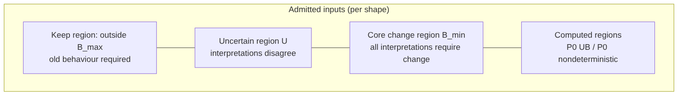
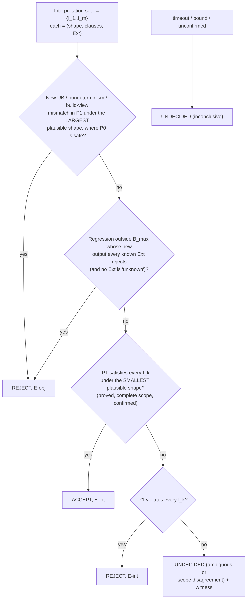
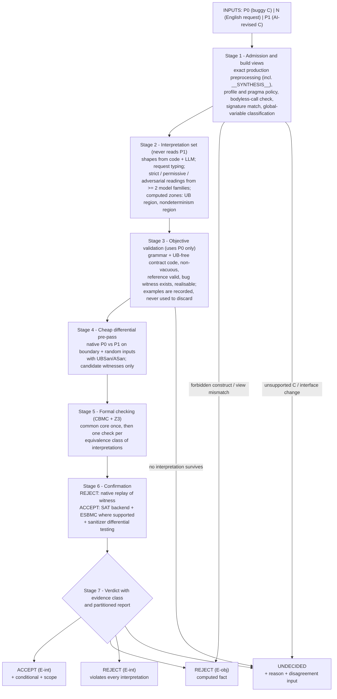
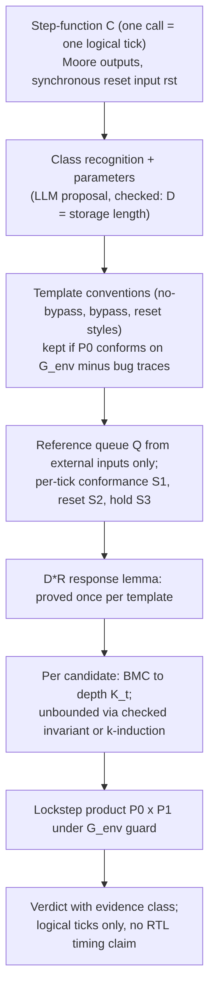
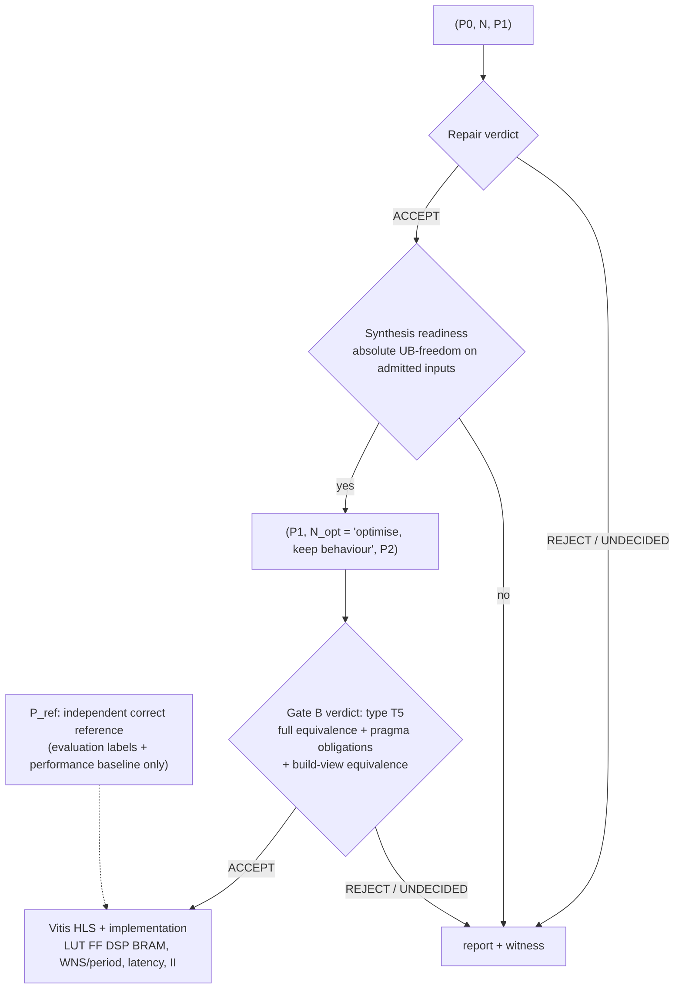

# Status of this document

**No experimental result is reported.** All verdicts in the examples are worked out by hand from the stated rules. They are what the implementation must reproduce. Statements are labelled as follows:

- **[Lit]**: supported by a cited paper or official tool documentation, read on 22 Nov 2026. "Abstract read" means only the abstract was checked.
- **[Derived]**: proved in this document.
- **[Scope]**: a restriction we choose.
- **[Hypothesis]**: not assumed true; tested in the evaluation.

Section 14 lists every scope restriction and hypothesis in one table.

# 1. Abstract

An LLM is asked to fix a specific bug in a C function and returns a revised function. We want a tool that decides, **with no human involved**, whether the revision does what was asked and nothing else. The tool's inputs are the buggy function $P_0$, the natural-language request $N$ and the revision $P_1$. Its output is **ACCEPT**, **REJECT** or **UNDECIDED**, with an **evidence class** and a concrete witness input.

No algorithm can guarantee that a natural-language request has been formalised correctly [1]. We therefore treat the task as *selective classification with formal evidence*. The tool:

1. builds a **set of interpretations** of the request, never looking at $P_1$. Each interpretation fixes three things: the size of every buffer, the region of inputs where behaviour must change, and the behaviour required there.
2. discards interpretations **only** for objective reasons, and computes some regions directly from $P_0$ (where it crashes or is nondeterministic) instead of asking the LLM;
3. checks $P_1$ formally against the whole set, using CBMC with an unmodified Z3 solver, and confirms results with a second solver, a second verifier where possible, and sanitizer-instrumented native runs;
4. accepts only if $P_1$ satisfies **every** interpretation, and rejects only on a computed fact or if $P_1$ violates **every** interpretation. Otherwise it abstains.

We prove the exact conditions under which each verdict class is correct (Theorems 1–4). The key point: a wrong decision requires **all** interpretations to be wrong in the same direction. How often that happens is the central measured quantity.

The same tool also checks the HLS optimisation step: an "optimise without changing behaviour" request is just a special case. A policy handles pragmas whose wrong use produces incorrect hardware, and verification runs on exactly the code that synthesis sees.

A scoped extension handles synchronous FIFO controllers with a validated temporal template and a proved response bound.

# 2. Introduction

## 2.1 Motivation

LLM-generated repairs often look plausible while being wrong.

- Test-based repair has long suffered from *overfitting*: patches pass the given tests but fail others [14].
- On SWE-bench Verified, differential testing found that 29.6% of patches that pass the tests behave differently from the developers' patches [12].
- An executable HLS repair benchmark from 2026 finds repair under-constraint common among LLM fixes for HLS kernels [38].

Formal verification can replace "passes some tests" with "correct for all admitted inputs". But it needs a specification, and here the only specification is a short English request.

## 2.2 The problem, in one line

$$\textsf{Verdict}(P_0, N, P_1) \in \{\textsf{ACCEPT}, \textsf{REJECT}, \textsf{UNDECIDED}\} \times \text{evidence} \times \text{witness}$$

## 2.3 Why the obvious solutions fail

| Approach | Failure |
|---|---|
| Prove $P_1 \equiv P_0$ | Rejects every real fix, because a fix changes behaviour on purpose. |
| Prove only the requested property | Accepts fixes that break everything else; e.g. "always return 255" satisfies "return 255 on overflow". |
| Ask an LLM whether $P_1$ is correct | Gives a prediction with no proof and no witness; LLM-based patch assessment is an active, unsolved area [10, 11]. |
| Generate one formal specification with an LLM and verify | Generated specifications can be weak or mirror the buggy code [3]; samples can collapse onto one wrong reading [4]. |
| Sample many specifications and trust agreement | Agreement is not evidence of correctness: semantic collapse [4]. |

## 2.4 Contributions (scoped; each is a claim to be tested, not an established result)

1. A formulation of fully automatic fix acceptance as **selective classification over a set of interpretations**. Buffer shapes, change regions and required behaviours are all interpretation dimensions, with exact soundness conditions for each verdict class (Section 5).
2. A **three-level evidence hierarchy** (E0 computed, E1 behaviour-light, E2 interpretive). It separates what the tool knows from what it infers.
3. A **pipeline design for C programs aimed at HLS** that closes the vacuity, path-cut, build-view and pragma loopholes identified by a systematic threat analysis (Sections 6–7 and 15).
4. An **evaluation protocol** that measures each hypothesis the theorems depend on, with risk–coverage analysis and matched-coverage baselines (Section 11).

We do **not** claim the following as new: conditional equivalence [15], relational and regression verification [16–18, 21, 22], LLM intent formalisation [1, 2], ambiguity detection [5, 6], LLM-inferred contracts for regression verification [20], or temporal-logic-guided repair [37].

## 2.5 Research questions

- **RQ1 (verdict quality).** Wrong-accept rate, wrong-reject rate and coverage, per evidence class and request type.
- **RQ2 (hypotheses behind the theorems).** How often does at least one surviving interpretation hold as sound, as complete, with a correctly bracketed zone, and with a correctly bracketed shape?
- **RQ3 (ablations).** What does each design element contribute?
- **RQ4 (baselines).** How does the tool compare with LLM-as-judge, tests generated from $N$, and implementation consensus, at matched coverage?
- **RQ5 (cost).** Time, solver calls, tokens and inconclusive rate.
- **RQ6 (temporal track).** How good are FIFO class recognition and verdicts?
- **RQ7 (HLS).** What are the Gate B outcomes and the QoR of accepted designs?
- **RQ8 (stability).** How often does the verdict change across independent generation runs?

# 3. Background and related work

**Comparing versions.**

- Regression verification proves two similar programs equivalent [21].
- Product programs reduce two-program properties to single-program verification [22].
- Conditional equivalence proves equivalence under a condition on the inputs, aimed at bug fixes and feature additions [15].
- Differential assertion checking and verification modulo versions check a new version *relative to* the old one ("relative correctness") [16, 17].
- Partition-based regression verification keeps guarantees for each input partition it has explored [18].
- Shadow symbolic execution generates inputs on which two versions diverge [19].
- A July 2026 preprint performs contract-based regression verification of C patches with LLM-inferred partial contracts [20] (abstract read).

**From English to specifications.**

- nl2postcond turns natural-language intent into postconditions and measures their correctness and discriminative power [2].
- Lahiri argues there is no algorithmic way to ensure a formalisation matches user intent, and proposes symbolic testing of specifications [1].
- LLM-generated specifications for incorrect C code can be weak or mirror the bug [3] (abstract read).
- Temporal-logic generation: nl2spec relies on interactive correction [32]; hardware-assertion generators report partial accuracy [33, 34].

**Ambiguity and consensus.**

- ClarifyGPT detects ambiguity by disagreement between sampled implementations on test inputs [5].
- CodeT selects code by dual agreement with generated tests [7].
- SEP groups candidate programs into equivalence classes with symbolic execution [8].
- Semantic collapse shows that agreement can hide ambiguity [4]; Jia et al. give a concrete single-cluster case [6].

**Patch correctness assessment.** A 2025 survey [11]; Quatrain correlates bug reports with patch descriptions [10]; a 2026 audit shows that reported detection rates depend on the candidate population, oracle rules and budget [13].

**Selective prediction.** A selective classifier may abstain. Its performance is the trade-off between *risk* (error rate on decided cases) and *coverage* (fraction decided), described by a risk–coverage curve [31].

**Positioning.**

| Work | Uses NL request | Formal proof | Checks requested change and preservation | Abstains with stated conditions | C/HLS |
|---|---|---|---|---|---|
| Quatrain [10], LLM judges [11] | yes | no | no | no | no |
| nl2postcond [2] | yes | spec only | no | no | no |
| Conditional equivalence [15], PRV [18] | no | yes | preservation | partial (PRV) | C via frontends |
| Partial Contracts Suffice [20] | no (abstract) | yes | preservation | not stated | C |
| ClarifyGPT [5] | yes | no | no | asks a human | no |
| **This work** | yes | yes | both | yes, with theorems | yes |

# 4. Problem formalisation

## 4.1 Programs and semantics

**C subset [Scope].** The subset contains:

- deterministic, single-threaded functions;
- integer and fixed-size types only, with a fixed data model (LP64, two's complement, signed narrowing defined as modulo $2^n$ as in GCC, recorded because C17 leaves it implementation-defined);
- no floating point, no heap in the programs under test, no recursion, no `volatile`, no `setjmp`/`longjmp`, no inline assembly;
- every callee has a body or is a whitelisted C-library function;
- no new `static` or global objects in $P_1$, except in the step-function class (Section 10).

$P_0$ and $P_1$ must have the same signature.

**Outcomes.** For an input $x$, $\mathit{Exec}(P,x)$ is the set of outcomes over all executions. Each outcome is $\mathsf{ok}(y)$ (return with observation $y$), $\mathsf{ub}$ (undefined behaviour or a failed check), or $\mathsf{div}$ (non-termination).

- $\mathit{Safe}(P,x)$: every outcome is $\mathsf{ok}$.
- $\mathit{Det}(P,x)$: $P$ is safe at $x$ and has exactly one outcome; then $P(x)$ denotes the observation.

**Observation** $y$ consists of:

- the return value;
- the final contents of every pointed-to region and every mutable global;
- pointers as (region, offset);
- structs compared field by field.

## 4.2 Shapes

A **shape** $\sigma$ gives the size of every pointed-to object as a function of the parameters (e.g. "`a` has `n` elements"), the alias pattern, and the classification of globals: constant globals keep their initialiser, mutable globals become inputs and outputs. $A_\sigma$ is the set of inputs consistent with $\sigma$ with sizes up to a bound $K$ **[Scope]**.

Shapes are ordered: $\sigma \sqsubseteq \sigma'$ if every buffer in $\sigma$ is no larger than in $\sigma'$ and the alias pattern is the same.

**Lemma S (shape transfer) [Derived].** Suppose $P$ is safe at logical input $x$ under shape $\sigma$, and $\sigma \sqsubseteq \sigma'$. Then $P$ is safe at $x$ under $\sigma'$ and produces the same observation on the shared part of memory.

*Proof.* Under $\sigma$, $P$ never accesses outside the $\sigma$-sized objects. Those accesses are within bounds under $\sigma'$ too. Every value $P$ reads is in the shared part, so execution is identical. Undefined behaviour that does not depend on memory size (overflow, shifts, division by zero) is unchanged. $\square$

Consequences:

- Safety and behaviour proved under a *small* shape carry over to every *larger* one.
- Undefined behaviour found under a *large* shape also occurs under every *smaller* one.

## 4.3 Intent and correctness

The user's intent is the unknown relation $I_N(x) \subseteq Y$. The true caller shape is $\sigma^{\ast}$, and the true change zone is $B^{\ast}$.

**[Scope S4] Localised requests.** For $x \notin B^{\ast}$, $I_N(x) = \{P_0(x)\}$ wherever $P_0$ is defined. Requests that rewrite the whole function are handled as "total" interpretations (type T4) or are out of scope.

Two correctness notions:

- **Repair-correct (RC).** For all $x \in A_{\sigma^{\ast}}$: if $\mathit{Safe}(P_0,x)$ or $x \in B^{\ast}$, then $\mathit{Det}(P_1,x)$ and $P_1(x) \in I_N(x)$.
  Inputs where $P_0$ already had undefined behaviour and the request is silent are not the request's business.
- **Synthesis-ready (SR).** RC, and additionally $\mathit{Det}(P_1, x)$ for **all** $x \in A_{\sigma^{\ast}}$.
  Needed before HLS: AMD warns that undefined behaviour is likely to make GCC and Vitis HLS behave differently, causing co-simulation mismatches [44].

**The basic limit [Lit].** There is no algorithmic way to ensure a formalisation matches user intent [1]. Hence:

**Definition (selective verdict).** The tool may abstain. Quality is measured by risk (wrong decisions among decided cases) and coverage, as in selective classification [31].

# 5. Theory: interpretation sets and verdicts

{width=6.4in}

## 5.1 Interpretations

An **interpretation** $I_k$ has three parts:

1. a shape $\sigma_k$;
2. clauses $\{(B_{k,i}, \varphi_{k,i})\}_i$. Each $B_{k,i}$ is a predicate on the initial input. Each $\varphi_{k,i}(x, y, y_0)$ relates the input, the new output $y$ and the old output $y_0 = P_0(x)$. Let $B_k = \bigcup_i B_{k,i}$.
3. an **extended behaviour** $\mathit{Ext}_k(x, y)$: the requested rule stated for every input where it is meaningful, or "unknown".

Together with $P_0$, it defines the **allowed outputs**:
$$\mathit{Allowed}_k(x) = \begin{cases} \{y : \bigwedge_{i:\,x \in B_{k,i}} \varphi_{k,i}(x, y, P_0(x))\} & x \in B_k \\ \{P_0(x)\} & x \in A_{\sigma_k}\setminus B_k,\ \mathit{Safe}(P_0, x) \\ Y & \text{otherwise (old UB, not mentioned)} \end{cases}$$

$\mathit{Sat}(P_1, I_k)$ means: for every $x \in A_{\sigma_k}$ that is in $B_k$ or where $P_0$ is safe, $P_1$ is deterministic and safe at $x$ and $P_1(x) \in \mathit{Allowed}_k(x)$.

**Sound and complete interpretations.**

- $I_k$ is **sound** if $\mathit{Allowed}_k(x) \subseteq I_N(x)$ wherever defined: at least as strict as the intent.
- $I_k$ is **complete** if $I_N(x) \subseteq \mathit{Allowed}_k(x)$: at least as permissive.

The **interpretation set** $\mathcal{I} = \{I_1, \dots, I_m\}$ is what survives validation (Section 6). From it we define:

- the zone bracket $B_{\min} = \bigcap_k B_k$, $B_{\max} = \bigcup_k B_k \cup B_{\text{reach}}$, where $B_{\text{reach}}$ is the "largest region the change could affect" proposed by the generators;
- the shape bracket $\sigma_{\min} = \bigsqcap_k \sigma_k$, $\sigma_{\max} = \bigsqcup_k \sigma_k$.

## 5.2 Verdict rules

Rules are applied in this order. The first that applies decides.

1. **REJECT, E0 (computed).** One of the following holds:
   - $P_1$ has undefined behaviour or nondeterminism at some $x$ under $\sigma_{\max}$, while $P_0$ is safe and deterministic at $x$ under $\sigma_{\min}$;
   - $P_1$'s synthesis view and simulation view differ;
   - $P_1$ uses a forbidden construct.
2. **REJECT, E1 (behaviour-light).** For some $x \in A_{\sigma_{\min}} \setminus B_{\max}$ where $P_0$ is safe: $P_1(x) \neq P_0(x)$, every $\mathit{Ext}_k$ is known, and $P_1(x) \notin \mathit{Ext}_k(x)$ for all $k$.
3. **ACCEPT, E2.** $\mathit{Sat}(P_1, I_k)$ is proved and confirmed for **every** $k$, with all checks done under $\sigma_{\min}$.
4. **REJECT, E2.** For **every** $k$ there is a confirmed witness $x_k \in A_{\sigma_{\min}}$ with $\neg\mathit{Sat}$ at $x_k$.
5. **UNDECIDED.** In all other cases:
   - *ambiguous*: some interpretations satisfied, some violated; the disagreement input is reported;
   - *scope disagreement*: a regression that some $\mathit{Ext}_k$ accepts or for which some $\mathit{Ext}_k$ is unknown;
   - *inconclusive*: timeout, incomplete bound, or an unconfirmed result.

{height=7.6in}

## 5.3 Theorems

All four theorems assume the **trusted base (TB)**: CBMC's semantics for the subset, and the solvers on which the result was confirmed. They also assume the **shape bracket** H-shape: $\sigma_{\min} \sqsubseteq \sigma^{\ast} \sqsubseteq \sigma_{\max}$.

**Theorem 1 (E0 rejects) [Derived].** Under TB and H-shape, an E0 REJECT means $P_1$ is not repair-correct.

*Proof.* $P_0$ is safe at $x$ under $\sigma_{\min}$, so by Lemma S it is safe under $\sigma^{\ast}$. $P_1$ has undefined behaviour at $x$ under $\sigma_{\max}$, so by the contrapositive of Lemma S it also does under $\sigma^{\ast}$. RC requires $\mathit{Det}(P_1, x)$ wherever $P_0$ is safe. A build-view mismatch means the synthesised program differs from the verified one, so no correctness claim transfers. $\square$

E0 needs **no** assumption about what $N$ means.

**Theorem 2 (E1 rejects) [Derived].** Assume TB, H-shape and S4, and **either** (H1) $B^{\ast} \subseteq B_{\max}$, **or** (H3-ext) some $\mathit{Ext}_k$ is complete at the witness $x$. Then an E1 REJECT means $P_1$ is not repair-correct.

*Proof.*

- If $x \notin B^{\ast}$, then $I_N(x) = \{P_0(x)\}$ by S4, so $P_1(x) \ne P_0(x)$ violates the intent.
- If $x \in B^{\ast}$, H1 fails, so H3-ext must hold: $P_1(x) \notin \mathit{Ext}_k(x) \supseteq I_N(x)$.
- $P_0$ and $P_1$ are both safe at $x$ under $\sigma_{\min}$, so by Lemma S the same outputs occur under $\sigma^{\ast}$. $\square$

**Theorem 3 (ACCEPT) [Derived].** Assume TB and H-shape, and suppose (H2) some $I_k$ is sound. Then ACCEPT implies $P_1$ is repair-correct within bound $K$.

*Proof.* ACCEPT includes $\mathit{Sat}(P_1, I_k)$ under $\sigma_{\min}$. By Lemma S, safety and outputs carry over to $\sigma^{\ast}$. By soundness, $P_1(x) \in \mathit{Allowed}_k(x) \subseteq I_N(x)$ wherever RC requires it. $\square$

**Theorem 4 (E2 rejects) [Derived].** Assume TB and H-shape, and suppose (H3) some $I_k$ is complete. Then an E2 REJECT implies $P_1$ is not repair-correct.

*Proof.* The witness $x_k$ for the complete $k$ satisfies $P_1(x_k) \notin \mathit{Allowed}_k(x_k) \supseteq I_N(x_k)$, or $P_1$ is unsafe at $x_k$ where RC requires safety. The witness transfers to $\sigma^{\ast}$ by Lemma S. $\square$

**Lemma 5 (monotonicity) [Derived].** If $\mathcal{I} \subseteq \mathcal{I}'$, every ACCEPT or E2 REJECT under $\mathcal{I}'$ is also given under $\mathcal{I}$. E2 decisions can only disappear as the set grows. E1 decisions can also only disappear, because $B_{\max}$ grows and more $\mathit{Ext}$ relations must reject.

**Consequences used in the design.**

- **(C1)** Removing an interpretation can only add decisions, and therefore risk. So interpretations are removed only on **objective** grounds.
- **(C2)** Taking the union of interpretation sets from several independent generation runs makes verdicts more conservative, never less.
- **(C3)** A wrong decision requires **every** interpretation to fail in the same direction:
  - a wrong ACCEPT needs every interpretation unsound;
  - a wrong E2 REJECT needs every interpretation incomplete;
  - a wrong E1 REJECT needs the zone bracket wrong **and** every $\mathit{Ext}$ incomplete at the witness.
- **(C4)** Strict readings target H2 and permissive readings target H3, so both are generated on purpose.

## 5.4 The partitioned report: separating facts from inferences

Besides the verdict, the tool reports **facts that hold regardless of interpretation**, given TB and H-shape, per region:

- $P_1$ agrees with $P_0$ on $A \setminus B_{\max}$ (proved or refuted);
- where $P_1$ differs from $P_0$, with witnesses;
- whether $P_1$ is safe everywhere (synthesis-ready);
- which interpretations $P_1$ satisfies.

This follows partition-based regression verification [18]. Even when the verdict is UNDECIDED, the user learns exactly what $P_1$ does.

# 6. The pipeline, stage by stage

{height=8.0in}

Each stage is presented as: role, evidence, design, how it can fail, and what remains.

## Stage 1 — Admission and build views

**Role.** Decide whether the code can be analysed soundly, and analyse *exactly* the code that will be synthesised.

**Evidence and design.**

1. **Build views [Lit].** Vitis HLS defines `__SYNTHESIS__` during synthesis, and AMD warns the macro is not obeyed by C simulation [44]. Preprocess $P_0$ and $P_1$ twice: once with the production macro set (synthesis view, including `-D__SYNTHESIS__`) and once with the simulation set. CBMC accepts `-D` and has a `--preprocess` mode [24]. Both views are verified, and they must be equivalent for $P_1$. If not, REJECT E0.
2. **Bodyless calls [Lit].** When a function has no body, CBMC warns, assumes the function has no side effects and returns an arbitrary value [24]. All functions without bodies are listed (`goto-instrument` provides this). Only whitelisted library functions with CBMC models are allowed; otherwise REJECT ($P_1$) or UNDECIDED ($P_0$).
3. **Path cuts [Lit].** `__CPROVER_assume(e)` silently ends executions where `e` is false [24]. The cbmc(1) manual documents an option *not* to simplify `while(1){}` into `assume(0)` [24]; it is always enabled. `abort`, `exit`, `_Exit` and `longjmp` get generated bodies `assert(0)` via `--generate-function-body` with the documented `assert-false` option [24]. Any `__CPROVER_` identifier in $P_1$ means REJECT. (How CBMC models `abort` by default was *not* verified; the fix does not depend on it.)
4. **Frontend robustness [Lit].** CBMC has had confirmed issues with switch-local and indeterminate variables (issues #3283, #7997) [24]. Declarations inside `switch` bodies and jumps into scopes are rejected.
5. **Pragma policy [Lit].** UG1399 warns that declaring a dependence false when it is not "can result in incorrect hardware" [44]. Pragmas are classified as:
   - *performance-only*: allowed;
   - *semantic assertions*: forbidden, or turned into proof obligations (Section 8.4);
   - *unknown*: UNDECIDED.
6. **Signature and globals.** The signatures must be equal; otherwise UNDECIDED (interface change). Globals are classified as in §4.2.

**Remaining risk.** Trust in CBMC's library models (H9).

## Stage 2 — Building the interpretation set (never reads $P_1$)

**Role.** Produce candidate interpretations with the diversity that Theorems 3–4 need.

**Evidence.**

- LLMs can formalise clear intent well [2].
- Generated specifications can mirror buggy code [3].
- Sampled outputs can collapse onto one reading [4, 6].
- Temperature 0 does not guarantee deterministic LLM output [30].

**Design.**

1. **Invariant: no LLM component ever reads $P_1$.** This prevents a contract being fitted to $P_1$ and blocks prompt injection from $P_1$.
2. **Request typing** (T1 explicit trigger and behaviour; T2 explicit trigger, standard behaviour; T3 safety fix; T4 implicit or total; T5 behaviour-preserving such as optimisation; T6 out of scope). A T3 claim is accepted only if CBMC finds undefined behaviour in $P_0$.
3. **Computed regions.**
   - $B_{ub}$: inputs where $P_0$ has undefined behaviour, found by CBMC checks over a total instrumented copy of $P_0$.
   - $B_{nd}$: inputs where two runs of $P_0$ disagree (self-composition), e.g. uninitialised reads, one of the bug classes in the HLS repair benchmark [38].
   - For T3 these are the change zone; for T5, $B = \emptyset$.
4. **Shapes are interpretation dimensions.** Candidate shapes come from:
   - usage in $P_0$ (loop bounds, indexing);
   - declared array types;
   - the LLM reading of $N$ and parameter names.

   Each interpretation carries its own shape. Its contract expressions must be free of undefined behaviour under that shape, which ties shape to meaning (Example 4).
5. **Readings.** At least two model families × three prompts:
   - **strict**: narrowest change region, most specific required behaviour;
   - **permissive**: widest acceptable behaviours;
   - **adversarial**: "find a reading under which the previous interpretation would be wrong".

   Each reading also gives $\mathit{Ext}$ (or "unknown") and the largest region the change could affect.
6. **Format.** Output is JSON matching a schema. Contract expressions use a restricted grammar (§8.2).
7. **Repetition.** Generation is repeated $r$ times and the union is taken (C2). The whole set is hashed and stored with the verdict, so any verdict can be re-run exactly.
8. **Provenance.** When $P_1$'s generator family is known, the formaliser uses other families (H8).

**Remaining risk.** Correlated collapse across all readings and families (H2–H4).

## Stage 3 — Objective validation (uses $P_0$ only)

**Role.** Remove interpretations that cannot describe the request, using only facts (consequence C1).

| Check | Condition (CBMC query) | Objective because |
|---|---|---|
| V-G Grammar and UB-free contract | expressions parse in the restricted grammar and evaluate without UB under $\sigma_k$ | property of the expression itself |
| V-1 Non-vacuous | $A_{\sigma_k}$, each $B_{k,i}$ and $A_{\sigma_k}\setminus B_k$ (unless total) are satisfiable | logical fact |
| V-2 Bug witness | $\exists x \in B_k$: $P_0(x) \notin \mathit{Allowed}_k(x)$ or $P_0$ unsafe at $x$ | follows from S3: the request asks for a change |
| V-3 Reference validity | $P_0$ safe and deterministic on $A_{\sigma_k}\setminus(B_k \cup B_{ub} \cup B_{nd})$, and wherever $\varphi$ mentions $y_0$ | property of $P_0$ |
| V-4 Realisable | each clause overlap satisfiable for every $x$ in it | logical fact |
| V-5 Shape sanity | under $\sigma_k$, $B_{ub}$ is a proper, small part of $A$ (estimated by sampling and reported) and consistent with the zone for T3 | otherwise $P_0$ is not a usable reference |

**Informational only (never used to discard):**

- agreement with independently generated input/output examples [9];
- semantic equivalence classes of interpretations (CBMC checks whether two $\mathit{Allowed}$ relations are equal), in the spirit of [8];
- the semantic distance between strict and permissive readings.

If no interpretation survives: UNDECIDED (cannot formalise).

## Stage 4 — Differential pre-pass (cost optimisation)

**Role.** Find cheap witnesses before running expensive proofs.

**Evidence.** Differential testing exposes behavioural divergence between patches [12]. Shadow symbolic execution targets divergence inputs [19].

**Design.**

- Compile $P_0$ and $P_1$ natively with UndefinedBehaviorSanitizer and AddressSanitizer.
- Run them on boundary values of every input (0, ±1, type limits, sizes 0, 1, $K$) and on random inputs drawn from $A_{\sigma_{\min}}$.
- Candidate witnesses (a divergence outside $B_{\max}$, or a sanitizer report in $P_1$ where $P_0$ is clean) are passed to Stage 5 as concrete inputs, for confirmation in the formal model.

The pre-pass can **never ACCEPT**. It only shortens the path to a REJECT.

## Stage 5 — Formal checking (CBMC + Z3)

**Harness rules (each closes an attack listed in Section 15).**

- Buffers are allocated with `malloc` of exactly the shape size, with symbolic size. CBMC tracks the object size (its own regression test asserts `__CPROVER_buffer_size(str) == len`) [24]. This catches off-by-one reads that fixed-size arrays would hide.
- Mutable globals are given unconstrained values identically in both copies (the CBMC harness pattern [24]).
- Outputs are compared with pointer-aware and field-wise equality.
- Standard checks are on: CBMC 6 enables pointer, bounds, division-by-zero, signed-overflow and undefined-shift checks by default [24]. The flags are also passed explicitly and recorded.
- Unwinding assertions are on. Loops are bounded or carry verified loop contracts with `decreases` clauses [24].
- Determinism is checked by self-composition.

**Order.**

1. The **common core** (E0 and E1 conditions) in one harness.
2. Then **one check per equivalence class** of interpretations.
3. Then the Stage 4 witnesses, confirmed in CBMC with fixed inputs.

**Solver.** Z3 through `--z3` or the incremental SMT2 backend (`--incremental-smt2-solver 'z3 -smt2 -in'`), whose documentation lists the supported C features [24].

## Stage 6 — Confirmation

**Evidence [Lit].** SMT solvers have had many soundness bugs found by fuzzing: 45 confirmed bugs in Z3 and CVC4 in four months [27]; 184 soundness bugs [28]; 483 soundness bugs over five years [29]. A cross-check that keeps the same frontend does not catch frontend bugs.

**Design.**

- **REJECT witnesses** are replayed natively under the sanitizers. Exception: witnesses relying on $P_0$'s undefined behaviour, which cannot be replayed meaningfully. A witness that does not reproduce gives UNDECIDED (tool discrepancy), logged for investigation.
- **ACCEPT** requires:
  - (i) the same harness proved with CBMC's SAT backend and with Z3;
  - (ii) ESBMC (a different frontend, Z3 by default [26]) on the same obligations, where its features allow; otherwise "single frontend" is recorded;
  - (iii) sanitizer differential testing of $P_1$ against each interpretation's executable check.
- Harness intrinsics are emitted through a thin per-tool layer. We do **not** assume CBMC and ESBMC share intrinsic names.

## Stage 7 — Verdict and report

The verdict is computed per Section 5.2. The report contains:

- the verdict, its evidence class and its printed conditional (e.g. "correct if at least one listed interpretation is sound and true buffer sizes lie between the listed shapes");
- the partitioned facts (§5.4);
- witnesses with the outputs of $P_0$ and $P_1$;
- each interpretation rendered back into English;
- the shapes, bound $K$, size estimate of $U$, tool versions, the interpretation-set hash and the timings.

After evaluation, the report also gives the **measured precision of each evidence class**.

**Optional concrete adjudication (off by default).** For ambiguous cases, an LLM is shown $N$, the disagreement input and the competing allowed outputs, never $P_1$'s output. Its answer produces a separate evidence class **E3**. By consequence C1, using it to delete interpretations would add risk, so E3 verdicts are reported and evaluated separately and are never merged into E0–E2.

# 7. Complete algorithm

```text
VERDICT(P0, N, P1):
  # Stage 1: admission and build views
  V0s, V0m <- preprocess(P0, SYNTH_MACROS), preprocess(P0, SIM_MACROS)
  V1s, V1m <- preprocess(P1, SYNTH_MACROS), preprocess(P1, SIM_MACROS)
  if has_cprover_ident(P1) or forbidden_construct(P1):  return REJECT(E0, "forbidden construct")
  if bodyless_non_whitelisted(V1s):                       return REJECT(E0, "unmodelled call")
  if signature(P1) != signature(P0):                      return UNDECIDED("interface change")
  if outside_profile(V0s, V1s) or unknown_pragma(P1):     return UNDECIDED("scope")
  globals <- classify_globals(V0s, V1s)

  # Stage 2: interpretation set (P1 is never shown to any LLM)
  types  <- classify(N); if "T3" in types and not cbmc_finds_ub(V0s): drop "T3"
  B_ub, B_nd <- computed_regions(V0s)
  shapes <- shapes_from_code(V0s) + shapes_from_types(V0s) + llm_shapes(N, sig(P0))
  I <- {}
  repeat r times:
    for family in FAMILIES, prompt in {strict, permissive, adversarial}:
      I += family.interpret(N, sig(P0), shapes, prompt)   # clauses, Ext, B_reach
  I += computed_interpretations(types, B_ub, B_nd)        # T3, T5
  # Stage 3: objective validation only
  I <- [k in I if V_G(k) and V_1(k) and V_2(k, V0s) and V_3(k, V0s) and V_4(k) and V_5(k)]
  if I is empty: return UNDECIDED("cannot formalise N")
  B_min, B_max, s_min, s_max <- brackets(I)
  store(hash(I))

  # Stage 4: differential pre-pass (can only produce candidate witnesses)
  W <- native_diff(V0s, V1s, boundary_and_random(A[s_min]), sanitizers=on)

  # Stage 5 + 6: core first
  r0 <- check_E0(V0s, V1s, V1m, s_min, s_max, W)
  if r0.violated and confirm(r0.witness):           return REJECT(E0, r0.witness, report)
  r1 <- check_E1(V0s, V1s, B_max, Ext(I), s_min, W)
  if r1.violated and confirm(r1.witness):           return REJECT(E1, r1.witness, report)
  res <- [check_sat(V0s, V1s, cls, s_min) for cls in equivalence_classes(I)]
  if any(res is INCONCLUSIVE or not confirmed):     return UNDECIDED("inconclusive", report)
  if all(res is PROVED) and confirm_accept(res):    return ACCEPT(E2, conditional, report)
  if all(res is VIOLATED):                          return REJECT(E2, witnesses, report)
  return UNDECIDED("ambiguous", disagreement_input, report)
```

# 8. Tool architecture and concrete artifacts

## 8.1 Components

| Component | Implementation choice | Notes |
|---|---|---|
| Orchestrator | Python | stage control, hashing, reports |
| C front work (preprocess, AST scan, globals, pragmas) | Clang/libclang + CBMC `--preprocess` | two build views |
| LLM clients | at least two model families | JSON-schema outputs only; never sees $P_1$ |
| Contract grammar and checker | small parser emitting C expressions | §8.2 |
| Harness generator | templates per obligation, per-tool intrinsic layer | §8.3 |
| Verifiers | CBMC 6.x (Z3 and SAT backends), ESBMC where supported | versions recorded |
| Native runner | GCC/Clang with `-fsanitize=undefined,address` | pre-pass and replay |
| Report | JSON + rendered HTML/PDF | partitioned facts, verdict, evidence, conditional |

## 8.2 Contract expression grammar (restricted)

```text
expr    := literal | input_var | out_var | old_var | expr binop expr | unop expr
         | expr ? expr : expr | forall(i, lo, hi, expr) | exists(i, lo, hi, expr)
         | input_var[expr] | out_var[expr] | old_var[expr] | pure_helper(expr, ...)
binop   := + - * / % << >> & | ^ == != < <= > >= && ||
lo, hi  := expressions over size parameters only (bounded quantifiers)
forbid  := calls other than whitelisted pure helpers, assignment, ++/--, pointer arithmetic,
           casts to pointer types, any __CPROVER_* identifier
```

Every expression is itself checked by CBMC to be free of undefined behaviour over its interpretation's domain (V-G). Arithmetic in contracts is done in a wider type where the meaning requires it (e.g. sums of `uint8_t` in `unsigned int`).

## 8.3 Example interpretation (JSON) and harness

The request is from Example 2 below: "When the array is empty, return INT_MIN and set idx to -1; otherwise keep the current behaviour."

```json
{
  "id": "I3-strict-familyB",
  "shape": {"a": {"elements": "n"}, "idx": {"elements": "1"}, "alias": "disjoint",
            "bounds": {"n": [0, 8]}},
  "clauses": [{"zone": "n == 0",
               "behaviour": "ret == INT_MIN && idx_out[0] == -1"}],
  "ext": "n == 0 ? (ret == INT_MIN && idx_out[0] == -1) : (ret == old_ret && idx_out[0] == old_idx[0])",
  "reach": "n == 0"
}
```

```c
/* E1 core harness (generated, simplified). The keep region is outside B_max. */
int main(void) {
  int n = nondet_int();  __CPROVER_assume(0 <= n && n <= 8);
  __CPROVER_assume(!(BMAX(n)));                      /* keep region */
  int *a0 = malloc(n * sizeof(int)), *a1 = malloc(n * sizeof(int));
  for (int i = 0; i < n; i++) { int v = nondet_int(); a0[i] = v; a1[i] = v; }
  int idx0, idx1;
  int r0 = p0_argmax(a0, n, &idx0);                   /* P0 safe here by V-3 */
  int r1 = p1_argmax(a1, n, &idx1);
  __CPROVER_assert(r0 == r1 && idx0 == idx1, "E1: preservation outside B_max");
}
```

## 8.4 Pragma policy (initial table, to be checked against the installed Vitis version)

| Pragma | Class | Handling |
|---|---|---|
| PIPELINE, UNROLL, ARRAY_PARTITION, INLINE, LOOP_TRIPCOUNT | performance-only | allowed; ignored by the C semantics |
| DEPENDENCE `false` | semantic assertion (documented risk of incorrect hardware [44]) | proof obligation: for the named array and type (intra/inter), no two accesses in the stated direction and distance touch the same element; otherwise REJECT E0 |
| DEPENDENCE `true` | constrains the schedule only | allowed |
| INTERFACE, top-level protocol changes | changes the observable interface | UNDECIDED (interface change) unless identical to $P_0$ |
| anything not in the table | unknown | UNDECIDED |

# 9. Worked examples (all verdicts hand-derived)

### Example 1 — Saturating addition (type T2)

- $P_0$: `uint8_t add8(a,b){ return (uint8_t)(a+b); }`
- $N$: "Use saturation instead of wrap-around; keep the result when the sum fits."
- **Interpretations.** Every reading gives zone $s = a+b > 255$ (computed in `unsigned`), behaviour $y = 255$, and $\mathit{Ext}$: $y = \min(s, 255)$. Shapes are trivial. $U = \emptyset$.
- **Validation.** V-2 holds at (250, 10), where $P_0$ returns 4.

| $P_1$ | Verdict | Evidence | Why |
|---|---|---|---|
| widen and saturate | ACCEPT | E2 | all interpretations proved and confirmed |
| `s=(uint8_t)(a+b); return s<a?255:s;` | ACCEPT | E2 | a different but correct carry test |
| always 255 | REJECT | E1 | witness (1,2): output 255, $P_0$ gives 3; every $\mathit{Ext}$ requires 3 |
| unchanged | REJECT | E2 | violates every interpretation at (250,10); not E0, because $P_0$ is defined there |
| 254 on overflow | REJECT | E2 | violates every interpretation |

### Example 2 — Empty array, old undefined behaviour, tie-break regression (T1 + T3)

- $P_0$ reads `a[0]` before the loop, so it reads out of bounds when `n == 0`.
- **Interpretations.** Shape "`a` has `n` elements" from both code and request. The computed region $B_{ub} = \{n = 0\}$ matches every reading's zone.

| $P_1$ | Verdict | Evidence | Why |
|---|---|---|---|
| correct fix | ACCEPT | E2 | |
| fixes `n == 0`, but `>=` picks the last tied index | REJECT | E1 | witness `a = {5,5}`: idx 1 vs 0, outside $B_{\max}$; every $\mathit{Ext}$ keeps old behaviour for $n \ge 1$; no tie-break specification needed |
| fixes `n == 0` by reading `a[n]` elsewhere | REJECT | E0 | new out-of-bounds read under $\sigma_{\max}$ where $P_0$ is safe |

### Example 3 — Scope disagreement instead of a false reject

- $P_0$: `avg = (a+b)/2` (truncates toward zero).
- $N$: "Round averages half away from zero."
- **Interpretations.** Suppose every reading's zone is "sum odd and negative" (a collapse), but one strict reading gives $\mathit{Ext}$ = "round half away from zero for all inputs".
- A correct $P_1$ changes $3/2$ from 1 to 2 *outside* $B_{\max}$. That $\mathit{Ext}$ accepts 2, so rule 2 does **not** fire: the result is UNDECIDED (scope disagreement), with witness (1, 2).
- If additionally the generators' "largest affected region" covers positive odd sums, $B_{\max}$ includes them and the result can be ACCEPT.
- **Why this matters.** A rule that treated every change outside $B_{\max}$ as a regression would reject this correct fix. Theorem 2's second condition, the $\mathit{Ext}$ check, prevents that.

### Example 4 — Off-by-one and the shape bracket

- $P_0$: `int sum(const int *a, int n){ int s=0; for(int i=0;i<n-1;i++) s+=a[i]; return s; }`, which misses the last element.
- $N$: "Include the last element in the sum."
- **Shapes.** Usage analysis of $P_0$ alone suggests "`a` has at least $n-1$ elements". The request implies $n$ elements. Every interpretation's behaviour clause, $y = \sum_{i<n} a[i]$, reads `a[n-1]`. V-G therefore discards the $(n-1)$ shape for those interpretations: the contract itself would have UB under it.
- So $\sigma_{\min} = \sigma_{\max} =$ "$n$ elements".

| $P_1$ | Verdict | Evidence |
|---|---|---|
| `i<n` | ACCEPT | E2 |
| `i<=n` (reads `a[n]`) | REJECT | E0 (new out-of-bounds read under $\sigma_{\max}$) |

- **Why shapes are interpretation dimensions.** If the shape were taken from $P_0$'s usage alone, the correct fix would be rejected as "new UB". Tying each shape to an interpretation, and requiring the contract to be UB-free under it, avoids this.

### Example 5 — An ambiguous request and the partitioned report

- $N$: "Handle overflow in add32."
- **Interpretations.** Strict: saturate. Permissive: "no undefined behaviour and no silently wrapped result". Adversarial: "return an error code".
- A $P_1$ that returns an error code satisfies the permissive and adversarial readings but not the strict one: **UNDECIDED (ambiguous)**, with the overflow witness.
- The **partitioned report** still states facts that hold regardless of interpretation:
  - $P_1 = P_0$ on all non-overflowing inputs (proved);
  - $P_1$ is free of undefined behaviour everywhere (synthesis-ready);
  - $P_1$'s outputs differ from $P_0$ exactly on the overflow inputs.
- **Collapse case.** If all generators had produced only "saturate", the same $P_1$ would get REJECT E2. That is wrong if the user accepted any non-wrapping behaviour, because Theorem 4's premise (some complete interpretation) fails. RQ2 measures this; the report's printed conditional makes the dependence visible.

### Example 6 — Safety fix (T3)

- $N$: "Fix the buffer overflow in `copy`."
- The zone is **computed**: inputs where $P_0$ writes out of bounds. The behaviour there is "defined"; elsewhere, preservation applies.
- A $P_1$ that fixes the overflow but truncates normal copies → REJECT E1, with a regression witness outside the computed zone.

### Example 7 — HLS optimisation gate (T5)

- $N_{opt}$: "Optimise for II = 1 without changing behaviour." $B = \emptyset$.

| $P_2$ | Verdict | Evidence | Why |
|---|---|---|---|
| (a) adds `#pragma HLS dependence variable=hist inter false` | REJECT | E0 | the generated obligation fails: consecutive iterations can update the same `hist` element (cf. the histogram example in UG1399) |
| (b) `#ifdef __SYNTHESIS__` selects a different loop body | REJECT | E0 | build views differ |
| (c) pure restructuring, equivalent | ACCEPT | E2 | trivially sound here, since $B = \emptyset$ leaves one interpretation; then synthesise and measure QoR (Section 11.6) |

### Example 8 — FIFO stall bug (Section 10)

- $N$: "Items are lost when the consumer stalls; fix it without changing behaviour when it never stalls."
- A $P_1$ that refuses input forever after the first stall → REJECT. Witness trace: a stall at tick 3, `in_ready = 0` at tick 4 while the reference queue has space.

# 10. Temporal extension: synchronous FIFO controllers

{height=5.8in}

**Model.**

- A step function is called once per logical tick and keeps its state in `static` variables.
- Outputs depend only on the state (Moore style).
- Reset is an explicit input `rst`, sampled synchronously. This is needed because Vitis's default reset configuration resets control registers only, not static data [44].

**Template, not free-form temporal logic [Lit].** Free-form NL-to-temporal-logic generation still needs review [32–34]. Recognised component classes therefore use validated templates. For the FIFO:

- the reference queue $Q$, updated only from external inputs and reference handshakes, with $rr = |Q| < D$ and $rv = |Q| > 0$;
- conformance S1: `in_ready` $= rr$, `out_valid` $= rv$, and data equals the head of $Q$ when valid;
- reset S2: $\mathbf{G}(rst \rightarrow \mathbf{X}(\neg \textit{out\_valid} \wedge \textit{in\_ready}))$;
- hold S3: for each data value $d$, $\mathbf{G}((\textit{out\_valid} \wedge \neg \textit{out\_ready} \wedge \neg rst \wedge \textit{out\_data} = d) \rightarrow \mathbf{X}(\textit{out\_valid} \wedge \textit{out\_data} = d))$.

**Response lemma [Derived].** If `out_ready` is true at least once in every $R$ consecutive ticks, an item accepted at tick $t$ is delivered by tick $t + DR$ or cancelled by reset. The bound is tight.

*Proof sketch.* The inductive invariant $c \le (D - k)R + w$ with $0 \le w \le R - 1$ holds, where $c$ counts ticks since acceptance, $k$ is the item's position in the queue and $w$ counts trailing non-ready ticks. While the item is pending, $k \ge 1$, so $c \le DR - 1$.

The lemma depends only on the reference, so it is proved once per template. Each candidate needs only S1–S3.

**Automation.**

- The LLM proposes the class and the stall guard $G_{env}$. $D$ is checked against the storage-array length in $P_0$.
- Template conventions (bypass or not, reset style) are kept if $P_0$ conforms on $G_{env}$ traces, excluding bug-witness traces. If $N$ mentions a convention change, both conventions are kept (Lemma 5).
- Per candidate:
  - bounded model checking to depth $K_t$;
  - unbounded proof via an LLM-proposed coupling invariant, *checked* by base case and inductive step, or via ESBMC k-induction;
  - otherwise the verdict is explicitly bounded.
- Optional engines: Ultimate LTL Automizer works directly on C programs [36]; nuXmv integrates MathSAT5 (not Z3) for infinite-state checking [35].

**Claim boundary.** Logical ticks of C code only. No claim about RTL cycles.

# 11. Evaluation design

## 11.1 Tasks

- **Sources:** CHStone and MachSuite kernels [43, 42]; IntroClass [40]; Codeflaws [41]; instances from the executable HLS repair benchmark where contents and license allow [38]; FIFO variants.
- **Fresh tasks:** written after the study starts, with renamed identifiers, to measure contamination.
- **Target size: about 40 tasks** (a plan, not a result).

## 11.2 Requests ($N$)

Three sources, reported separately:

1. requests written by a person with no access to the tool's prompts, following a fixed brief (observed failure + desired change);
2. two paraphrases each;
3. requests from an independent group of students shown only the buggy behaviour.

A subset gets deliberately ambiguous versions, with ambiguity labels (in the spirit of the Orchid benchmark [47]). Prompt-injection variants test the "never reads $P_1$" invariant.

## 11.3 Ground truth

- Each task has an independently written reference $P_{ref}$ and a specification $\Phi_{ref}$, written by someone other than the request author and the tool designers.
- A candidate is **repair-correct** iff it is safe where required and satisfies $\Phi_{ref}$. This is checked formally and cross-checked by held-out tests.
- Ambiguous tasks list every acceptable interpretation.
- **Measuring the hypotheses (RQ2).** For each surviving interpretation, two CBMC queries against $\Phi_{ref}$ decide whether it is sound and/or complete. H1 (zone bracket) and H-shape are checked against $\Phi_{ref}$'s zone and the reference shape. This turns the theorems' premises into measured quantities.

## 11.4 Candidate pool

- LLM fixes from at least two families. Provenance is recorded and results are stratified by whether the generator family matches the formaliser's.
- Seeded faults: off-by-one; regression outside the zone; no fix; wrong constant; tie-break change; new UB; build-view trick; false dependence pragma; FIFO refusal.
- Equivalent mutants get their semantic label. Natural and seeded results are reported separately, because the candidate population changes measured rates [13].
- Target: about 10 candidates per task, about 400 in total.

## 11.5 Baselines (same models and same budgets)

1. **LLM-as-judge** on $(P_0, N, P_1)$, with a confidence score, so that it can be compared at matched coverage.
2. **Generated tests**: tests from $N$ (LIBRO/CodeT style) [7, 9].
3. **Implementation consensus**: independent LLM fixes clustered by CBMC equivalence; accept if $P_1$ falls in the largest cluster (SEP-like [8]).
4. **Single unvalidated interpretation**: one LLM-generated contract, checked formally, with no interpretation set and no validation.

## 11.6 Metrics and statistics

- **Risk–coverage curve** [31] for every method. The headline numbers are the wrong-accept rate and wrong-reject rate at each method's natural operating point, and at matched coverage.
- **Per evidence class:** precision with Wilson 95% intervals.
  - Planning figures, computed: with 200 incorrect candidates and 0 wrong accepts, the 95% upper bound is 1.9%. With 10 of 200 wrong, the interval is [2.7%, 9.0%].
  - So about 400 candidates can separate error rates around 2% from rates around 10%, but not finer differences. These are interval widths, not results.
- **Paired comparisons:** exact McNemar tests with Holm correction; hypotheses and analysis pre-registered.
- **Ablations (RQ3):** strict/permissive/adversarial prompting; one vs. several model families; each validation check; $r$ (number of generation runs); shapes as interpretations vs. a single shape; the $\mathit{Ext}$ rule; the pre-pass (cost only); confirmation steps.
- **Stability (RQ8):** verdict agreement across 3 independent generation runs.
- **HLS QoR (RQ7)**, for designs that pass the HLS gates:
  - LUT, FF, DSP, BRAM;
  - post-implementation timing (WNS and achieved period);
  - latency (min and max cycles) and II;
  - fixed tool version, part, clock target and interfaces;
  - compared against $P_{ref}$.

# 12. HLS integration

{height=6.2in}

1. **Repair verdict** on $(P_0, N, P_1)$.
2. **Synthesis readiness:** absolute safety on admitted inputs (SR in §4.3).
3. **Gate B:** $(P_1, N_{opt}, P_2)$ as type T5. This means full equivalence, the pragma obligations and build-view equivalence.
4. **Synthesis and implementation:** QoR is measured only for designs that passed, and compared with $P_{ref}$ (never with the buggy $P_0$).

**Trust boundary.** The HLS compiler remains trusted. C/RTL co-simulation, with a testbench built from witnesses and boundary inputs, tests traces but proves nothing. A formal C-to-RTL claim would need bounded C-versus-Verilog checking in the style of hw-cbmc [45, 46]. That is future work.

# 13. Threats to validity and limitations

- **Basic limit.** E2 verdicts are conditional on H2 or H3, which cannot be checked at run time [1]. Their measured precision is the main empirical result.
- **Correlated collapse** across zones, $\mathit{Ext}$ relations, shapes and model families is the dominant remaining way to make wrong decisions.
- **Trusted base.** CBMC/ESBMC semantics, library models, Z3, compilers and sanitizers. This risk is reduced by diversity, not removed.
- **Scope.** The C subset; bound $K$; template-only temporal classes; localised requests.
- **External validity.** Benchmark requests may be cleaner than real ones; contamination; LLM versions change.
- **Construct validity.** $\Phi_{ref}$ may itself be incomplete.

# 14. Assumption register

| ID | Statement | Kind | Used by | Handling |
|---|---|---|---|---|
| S1 | C subset of §4.1 | Scope | all | outside → UNDECIDED |
| S2 | sizes $\le K$; loops fully unwound or contract-verified | Scope | Stage 5 | printed in the verdict |
| S3 | $N$ asks for a behaviour change (else T5) | Scope | V-2 | typing |
| S4 | localised request | Scope | Thm 2 | total requests → T4 or out of scope |
| S5 | pragma table matches the installed Vitis version | Scope | Stage 1 | unknown → UNDECIDED |
| TB | CBMC/ESBMC semantics, library models, Z3/SAT, sanitizers correct on the confirmed results | Trusted base | all | diversity, replay |
| H-shape | $\sigma_{\min} \sqsubseteq \sigma^{\ast} \sqsubseteq \sigma_{\max}$ | Hypothesis | Thms 1–4 | measured (RQ2) |
| H1 | $B^{\ast} \subseteq B_{\max}$ | Hypothesis | Thm 2 | measured |
| H2 | some surviving interpretation is sound | Hypothesis | Thm 3 | measured |
| H3 | some surviving interpretation is complete | Hypothesis | Thm 4 | measured |
| H3-ext | some $\mathit{Ext}$ is complete at E1 witnesses | Hypothesis | Thm 2 | measured |
| H4 | several families and strict/permissive/adversarial prompting reduce collapse | Hypothesis | Stage 2 | ablation |
| H5 | objective validation removes more wrong interpretations than right ones | Hypothesis | Stage 3 | ablation |
| H6 | the tool beats the baselines at matched coverage | Hypothesis | — | RQ4 |
| H9 | CBMC library models of whitelisted C-library functions are correct | Trusted base | Stage 1 | whitelist kept small; covered by differential testing |
| H8 | formaliser families differ from $P_1$'s generator, or this is reported unknown | Scope/reporting | Stage 2 | stratified analysis |

# 15. Threat model and design defences

The design was stress-tested by attempting to make the pipeline (i) return a wrong ACCEPT, (ii) return a wrong REJECT, or (iii) make a stated guarantee false or vacuous. Each attack below is answered by a specific design element. Tool facts the attacks rely on were checked in official documentation or issue trackers [24, 44] or in the cited studies.

| # | Attack | Design element that defends against it |
|---|---|---|
| T1 | All interpretations under-estimate the change zone, so a correct fix looks like a regression (Example 3) | E1 rejects require every $\mathit{Ext}$ to reject the new output (Theorem 2); generators also propose the largest affected region |
| T2 | Discarding interpretations on soft evidence (LLM-generated examples) removes the only sound one | Only objective checks discard interpretations (Lemma 5, C1); examples are informational |
| T3 | Fixed-size harness arrays hide off-by-one reads | Buffers allocated with exact symbolic size |
| T4 | A shape taken from the buggy code is too small for the fixed code (Example 4) | Shapes are interpretation dimensions; contracts must be UB-free under their own shape; Lemma S and the shape bracket |
| T5 | Nondeterministic $P_0$ (uninitialised reads) makes "same as before" ill-defined | Self-composition computes $B_{nd}$, treated like $B_{ub}$ |
| T6 | Functions without bodies are modelled without side effects | Bodyless calls listed; only whitelisted library models allowed |
| T7 | Path cuts (`assume`, `while(1){}`, `abort`) make proofs vacuous | Loops kept as loops; abnormal-termination functions get `assert(0)` bodies; `__CPROVER_` identifiers forbidden in $P_1$ |
| T8 | Different code under `__SYNTHESIS__` | Two build views verified and required equivalent |
| T9 | HLS pragmas that assert false facts (DEPENDENCE false) | Pragma policy: performance-only allowed, semantic assertions become proof obligations, unknown pragmas give UNDECIDED |
| T10 | LLM-written contract code injected into the harness (side effects, UB, `assume(0)`) | Restricted grammar; contract expressions checked UB-free |
| T11 | Hidden inputs and outputs in global variables | Globals classified; mutable globals are inputs and outputs |
| T12 | Pointer or struct outputs compared by raw bytes | Pointer-aware, field-wise comparison |
| T13 | Solver or frontend bugs produce false proofs [27–29] | SAT + Z3, ESBMC where supported, sanitizer replay of witnesses, differential testing on ACCEPT |
| T14 | The fix-writer and the formaliser share a misreading | Different model families for the formaliser; provenance stratification |
| T15 | LLM nondeterminism makes verdicts unrepeatable [30] | Frozen, hashed interpretation sets; union over runs (C2); stability metric RQ8 |
| T16 | Prompt injection through $P_1$ | No LLM component reads $P_1$; JSON schema and grammar on all LLM output |
| T17 | Remaining old UB reaches the HLS tool | Separate synthesis-readiness gate requiring absolute safety |
| T18 | An "always UNDECIDED" tool looks safe | Risk–coverage curves and matched-coverage baselines |
| T19 | Regression rejects described as certain although they depend on hypotheses | Evidence hierarchy E0/E1/E2 with printed conditionals and measured precision |
| T20 | An LLM adjudicator removes interpretations on soft evidence | Adjudication kept separate as E3, never merged |
| T21 | Benchmark contamination and candidate-population effects [13] | Fresh tasks; natural vs. seeded candidates reported separately |
| T22 | Verifier intrinsics differ between CBMC and ESBMC | Per-tool intrinsic layer in the harness generator |

# 16. Implementation milestones

| Weeks | Milestone | Exit criterion |
|---|---|---|
| 1–2 | Stage 1 (two build views, admission, pragma table, globals) and harness templates with exact-size buffers | Examples 1, 2 and 7(b) reproduce with hand-written interpretations |
| 3–4 | Stage 2 (typing, computed regions, shapes, multi-family JSON readings) and Stage 3 checks | Interpretation sets generated automatically for Examples 1–6; V-G rejects the $(n-1)$ shape in Example 4 |
| 5 | Stages 4–6 (pre-pass, core-first checking, SAT/Z3/ESBMC confirmation, sanitizer replay) | All eight examples reproduced or corrected, with logs |
| 6–7 | Dataset, labels, candidate pool, baselines | Frozen, pre-registered evaluation package |
| 8 | Evaluation RQ1–RQ5, RQ8 | Risk–coverage curves with intervals |
| 9 | FIFO track and HLS gates and QoR | Example 8 reproduced; QoR table or documented protocol |
| 10 | Report | |

**Research-only fallback.** The formalisation, Theorems 1–4, Lemmas S and 5, the worked examples and the pre-registered protocol form a complete design study even if the pipeline is only partly built. Running Stages 1, 5 and 6 with hand-written interpretations already turns the examples into reproduced results.

# References

[1] S. K. Lahiri. Evaluating LLM-driven User-Intent Formalization for Verification-Aware Languages. FMCAD 2024. arXiv:2406.09757.

[2] M. Endres, S. Fakhoury, S. Chakraborty, S. K. Lahiri. Can Large Language Models Transform Natural Language Intent into Formal Method Postconditions? FSE 2024 (PACMSE). arXiv:2310.01831.

[3] W. Wang, S. Chen, Z. Sun, S. Feng. Are LLM-Generated Formal Specifications Faithful to Their Requirements? arXiv:2610.32053, 2026 (preprint; abstract read).

[4] C. Richter, M. Papadakis. Underspecification does not imply Incoherence: The Risks of Semantic Collapse in Coding Models. arXiv:2607.01953, 2026 (preprint; abstract read).

[5] F. Mu et al. ClarifyGPT: A Framework for Enhancing LLM-Based Code Generation via Requirements Clarification. FSE 2024, DOI 10.1145/3660810.

[6] H. Jia, R. Morris, H. Ye, F. Sarro, S. Mechtaev. Automated Repair of Ambiguous Problem Descriptions for LLM-Based Code Generation. arXiv:2505.07270, 2025 (venue not verified).

[7] B. Chen et al. CodeT: Code Generation with Generated Tests. ICLR 2023.

[8] D. Cho, Y. Wang, F. Sui, A. Grama. Inference-Time Code Selection via Symbolic Equivalence Partitioning. arXiv:2604.06485, 2026 (preprint).

[9] S. Kang, J. Yoon, S. Yoo. Large Language Models are Few-shot Testers: Exploring LLM-based General Bug Reproduction. ICSE 2023.

[10] H. Tian et al. Is this Change the Answer to that Problem? Correlating Descriptions of Bug and Code Changes for Evaluating Patch Correctness. ASE 2022.

[11] Z. Fei et al. Patch Correctness Assessment: A Survey. ACM TOSEM 34(2), 2025, DOI 10.1145/3702972.

[12] Y. Wang, M. Pradel, Z. Liu. Are "Solved Issues" in SWE-bench Really Solved Correctly? ICSE 2026, DOI 10.1145/3744916.3764576.

[13] S. Wu et al. Patch correctness in automated program repair: A five-dimensional evidence framework and cross-benchmark audit. arXiv:2611.10837, 2026 (preprint).

[14] E. K. Smith, E. T. Barr, C. Le Goues, Y. Brun. Is the Cure Worse Than the Disease? Overfitting in Automated Program Repair. ESEC/FSE 2015.

[15] M. Kawaguchi, S. K. Lahiri, H. Rebêlo. Conditional Equivalence. MSR-TR-2010-119, 2010.

[16] S. K. Lahiri, K. L. McMillan, R. Sharma, C. Hawblitzel. Differential Assertion Checking. ESEC/FSE 2013.

[17] F. Logozzo, S. K. Lahiri, M. Fähndrich, S. Blackshear. Verification Modulo Versions: Towards Usable Verification. PLDI 2014.

[18] M. Böhme, B. C. d. S. Oliveira, A. Roychoudhury. Partition-Based Regression Verification. ICSE 2013.

[19] T. Kuchta, H. Palikareva, C. Cadar. Shadow Symbolic Execution for Testing Software Patches. ACM TOSEM 27(3), 2018.

[20] Y. Charalambous, R. Menezes, Y. Sun, L. C. Cordeiro. Partial Contracts Suffice: Sound, LLM-Inferred Regression Verification. arXiv:2607.10291, 2026 (preprint; abstract read).

[21] B. Godlin, O. Strichman. Regression Verification: Proving the Equivalence of Similar Programs. STVR 23(3), 2013.

[22] G. Barthe, J. M. Crespo, C. Kunz. Relational Verification Using Product Programs. FM 2011.

[23] D. Kroening, P. Schrammel, M. Tautschnig. CBMC: The C Bounded Model Checker. arXiv:2302.02384, 2023.

[24] CBMC documentation, accessed 22 Nov 2026:

- cbmc(1) and goto-instrument(1) manual pages for CBMC 6.1.1: standard checks, the `while(1){}` simplification option, `--generate-function-body`, listing functions without body, solver options;
- the CPROVER manual: API, memory primitives, malloc model, incremental SMT2 backend, code contracts;
- the CBMC training page "Proof assumptions";
- the CBMC starter-kit harness guidance;
- issues #3283 and #7997.

[25] N. Bjørner, L. de Moura, L. Nachmanson, C. Wintersteiger. Programming Z3.

[26] J. Morse, L. Cordeiro, D. Nicole, B. Fischer. Handling Unbounded Loops with ESBMC 1.20. TACAS 2013; ESBMC repository (Z3 default solver).

[27] D. Winterer, C. Zhang, Z. Su. Validating SMT Solvers via Semantic Fusion. PLDI 2020.

[28] D. Winterer, C. Zhang, Z. Su. On the Unusual Effectiveness of Type-Aware Operator Mutations for Testing SMT Solvers. arXiv:2004.08799, 2020.

[29] D. Winterer. Solidifying Modern SMT Solvers. Doctoral thesis, ETH Zurich.

[30] S. Ouyang, J. M. Zhang, M. Harman, M. Wang. An Empirical Study of the Non-determinism of ChatGPT in Code Generation. ACM TOSEM 34, 2025.

[31] Y. Geifman, R. El-Yaniv. Selective Classification for Deep Neural Networks. NeurIPS 2017.

[32] M. Cosler et al. nl2spec. CAV 2023.

[33] W. Fang et al. AssertLLM. arXiv:2402.00386 (venue not verified).

[34] SpecAlign: A Semantic Alignment Framework for SystemVerilog Assertion Generation. arXiv:2605.25181, 2026 (preprint; authors not recorded).

[35] R. Cavada et al. The nuXmv Symbolic Model Checker. CAV 2014; nuXmv features page.

[36] D. Dietsch, M. Heizmann, V. Langenfeld, A. Podelski. Fairness Modulo Theory: A New Approach to LTL Software Model Checking. CAV 2015 (author list not re-verified); Ultimate LTL Automizer page.

[37] Y. Liu, Y. Song, M. Mirchev, A. Roychoudhury. Computation Tree Logic Guided Program Repair. IEEE TSE (Xplore 11218954); arXiv:2502.15344.

[38] M. Mastora, D. Sullivan. An Executable Benchmark for LLM-Based HLS Repair: Design Complexity and Repair Underconstraint. arXiv:2610.03971, 2026 (preprint).

[39] Chrysalis-HLS dataset, UIUC ChenLab (ASP-DAC 2024 invited paper; authors not verified).

[40] C. Le Goues et al. The ManyBugs and IntroClass Benchmarks for Automated Repair of C Programs. IEEE TSE 41(12), 2015.

[41] S. H. Tan, J. Yi, Yulis, S. Mechtaev, A. Roychoudhury. Codeflaws. ICSE 2017 (companion/poster).

[42] B. Reagen et al. MachSuite. IISWC 2014.

[43] Y. Hara et al. CHStone. ISCAS 2008.

[44] AMD. Vitis High-Level Synthesis User Guide (UG1399): System Calls (`__SYNTHESIS__`, 2025.2 page); Undefined Behaviors; pragma HLS dependence; Controlling Initialization and Reset Behavior; config_rtl (2026.1 pages).

[45] D. Kroening, E. Clarke, K. Yorav. Behavioral Consistency of C and Verilog Programs Using Bounded Model Checking. DAC 2003.

[46] R. Mukherjee et al. Equivalence Checking of a Floating-Point Unit Against a High-Level C Model. FM 2016.

[47] D. Yang et al. Assessing the Impact of Requirement Ambiguity on LLM-based Function-Level Code Generation (Orchid). arXiv:2604.21505, 2026 (preprint).
