# Technical Design Document — Verdicts with Evidence (VWE)

**Purpose.** How to build, run and test the system described in the research draft `docs/research/Verdicts_with_Evidence_Final_Draft.pdf`. Definitions ($P_0$, $N$, $P_1$, interpretations, shapes, $B_{\min}$/$B_{\max}$, $\mathit{Ext}$, E0/E1/E2, repair-correct and synthesis-ready) are the draft's. Where implementation facts differ from the draft's assumptions, this document uses the corrected facts from `01_review_of_final_draft.md`.

**Status labels used below.**

- **[implemented]**: code exists in this repository and is tested.
- **[spiked]**: demonstrated by a runnable spike in `spikes/`.
- **[designed]**: specified here, not yet built.
- **[verify]**: depends on something not yet checked on the target machine.

---

## 1. Scope and non-goals

**In scope (first implementation).**

- Single C functions within the subset of draft §4.1:
  - integer types only;
  - no heap in the code under test, no recursion, no floating point, no `volatile`, no concurrency;
  - all callees have bodies or are whitelisted library functions;
  - same signature for $P_0$ and $P_1$.
- Pointer parameters with **disjoint** buffers. Sizes are expressions over size parameters, bounded by $K$ (default $K = 8$, configurable per task).
- Request types T1–T5. T6 is detected and reported UNDECIDED.
- The FIFO step-function template (draft §10).
- The HLS gates: synthesis-readiness, Gate B, and QoR measurement where Vitis HLS is installed.

**Out of scope (reported as UNDECIDED, never guessed).**

- Aliasing patterns other than disjoint.
- Floating point; `ap_int`/`ap_fixed`; C++ classes.
- Unbounded proofs without loop contracts or k-induction.
- Interface changes.
- Temporal properties outside the template classes.
- Any claim about RTL correctness.

---

## 2. Architecture

```mermaid
flowchart LR
  subgraph IN[Inputs]
    P0[P0.c]:::f
    N[N.txt]:::f
    P1[P1.c]:::f
  end
  subgraph S1[Stage 1 admission]
    PP[preprocess x2<br/>synth / sim views]
    AD[admission checks<br/>profile, pragmas,<br/>undefined functions,<br/>signature, globals]
  end
  subgraph S2[Stage 2 interpretations]
    TY[request typing]
    CR[computed regions<br/>B_ub, B_nd via CBMC]
    SH[shape candidates]
    LLM[LLM readings<br/>strict / permissive / adversarial<br/>never sees P1]
  end
  subgraph S3[Stage 3 validation]
    GR[contract grammar<br/>+ translation to C]
    VAL[V-G, V-1..V-5<br/>CBMC queries on P0]
    EQ[equivalence classes]
    HASH[freeze + sha256]
  end
  subgraph S4[Stage 4 pre-pass]
    NAT[native diff run<br/>GCC + ASan/UBSan]
  end
  subgraph S5[Stage 5-6 formal + confirmation]
    HG[harness generator]
    CB[CBMC SAT + Z3]
    ES[ESBMC confirm-only]
    RP[native witness replay]
  end
  subgraph S7[Stage 7 verdict]
    VD[vwe.verdict.decide]
    REP[report JSON + HTML]
  end
  P0 --> PP; P1 --> PP; PP --> AD
  N --> TY; N --> LLM; AD --> CR; AD --> SH
  TY --> LLM; SH --> LLM; CR --> VAL; LLM --> GR --> VAL --> EQ --> HASH
  HASH --> NAT --> HG --> CB --> ES --> RP --> VD --> REP
```



**Process model.**

- One orchestrator process (Python) runs per task, plus worker processes for tool runs (`concurrent.futures.ProcessPoolExecutor`). Every external tool runs as a subprocess with a timeout.
- There is no shared mutable state between tasks. Every artifact is written under `runs/<task_id>/<candidate_id>/<run_id>/`.

**Security boundary.**

- No LLM component receives $P_1$ or anything derived from it. This is enforced in code: the LLM client accepts only a `RequestContext` object, built from $N$ and $P_0$'s signature, and it is unit-tested.
- Native execution of candidates happens only in the sandboxed pre-pass and replay steps, inside the container, with no network.

---

## 3. Technology choices and versions

| Component | Choice | Version (pinned) | Why | Status |
|---|---|---|---|---|
| Orchestrator | Python | 3.12 (≥ 3.10 supported) | ecosystem for JSON Schema, subprocess, LLM SDKs | [implemented] |
| Bounded model checker (primary) | CBMC | **6.11.0** (`ubuntu-24.04-cbmc-6.11.0-Linux.deb` from github.com/diffblue/cbmc releases) | bit-precise C semantics, standard checks, unwinding assertions, JSON output, loop contracts | [spiked] |
| SMT backend | Z3 | **5.4.1** (PyPI `z3-solver`, provides the `z3` executable) | required by the course brief; used via `--z3` and `--incremental-smt2-solver 'z3 -smt2 -in'` | [spiked] |
| SAT backend | CBMC built-in default | bundled with CBMC 6.11.0 | solver diversity | [spiked] |
| Second frontend (confirm-only) | ESBMC | **8.7.0** (`esbmc-linux.zip` from github.com/esbmc/esbmc release v8.7); bundles Z3 4.13.3 | independent frontend; k-induction for loops and the FIFO track | [spiked] |
| Optional extra SMT | cvc5 / Bitwuzla via CBMC `--cvc5` / `--bitwuzla` | — | non-Z3 diversity | [verify] install |
| C preprocessing / AST | `cbmc --preprocess` (exact view) + `pycparser` 3.0 for structural scans on preprocessed text | — | pycparser parses preprocessed C99; libclang optional for richer analysis | [designed] |
| Native compiler + sanitizers | GCC | **13.3.0** with `-fsanitize=address,undefined -g -O0` | pre-pass and witness replay; Clang 18 runtime missing in the reference environment | [spiked] |
| JSON Schema | `jsonschema` 4.26 + `referencing` | — | schema validation | [implemented] |
| Tests | `pytest` 9.1 | — | unit + golden tests | [implemented] |
| LLM providers | provider-neutral client; ≥ 2 model families (e.g. one Anthropic Claude model and one OpenAI GPT model); exact model IDs pinned in `config/llm.toml` | pinned at setup | draft H4/H8 need ≥ 2 families | [designed] |
| HLS | AMD Vitis HLS | **2026.1** (UG1399 2026.1 is the latest English edition confirmed) | Gate B and QoR | [verify] CLI on the installed version |
| Container | Docker, base `ubuntu:24.04` | — | reproducibility | [designed] (`docker/Dockerfile`) |

**Why CBMC is primary and ESBMC confirm-only.** CBMC has the documented and tested defences against path cuts (`--no-self-loops-to-assumptions`; generated `assert-false-assume-false` bodies). ESBMC 8.7.0 was shown to pass the `while(1)` and `abort()` tricks (review R3). ACCEPT requires both tools to agree, so ESBMC can only *block* an ACCEPT, never create one.

---

## 4. Repository layout and module interfaces

```text
docs/research/                     research draft (PDF + Markdown + figures)
docs/technical-design/             this document, the review, the links/versions log
schemas/                           JSON Schemas (interpretation, set, task, report)
vwe/                               Python package
  __init__.py
  config.py           [designed]   loads config/*.toml (bounds K, timeouts, model IDs)
  admission.py        [designed]   Stage 1
  views.py            [designed]   preprocessing into synth/sim views
  typing_.py          [designed]   request typing (LLM + checks)
  regions.py          [designed]   B_ub / B_nd computation via CBMC
  shapes.py           [designed]   shape candidates
  llm/                [designed]   provider-neutral client, prompts, schema-enforced parsing
  contract/           [designed]   grammar, parser, type checker, C emitter
  validate.py         [designed]   V-G, V-1..V-5, equivalence classes, freezing + hashing
  prepass.py          [designed]   native differential run
  harness/            [designed]   templates + generator (E0, E1, per-class, vacuity, views, B_ub, B_nd)
  tools/cbmc.py       [implemented] CBMC runner + JSON parsing + witness extraction
  tools/esbmc.py      [designed]   ESBMC runner (confirm-only)
  tools/native.py     [designed]   GCC build + sanitizer replay
  verdict.py          [implemented] verdict rules of draft §5.2
  report.py           [designed]   VerdictReport JSON + HTML
  schemas.py          [implemented] schema loading/validation
  fifo/               [designed]   step-function harness, reference queue, BMC/k-induction
  hls/                [designed]   Gate B, Vitis scripts, QoR extraction
  eval/               [designed]   candidate pools, labelling, baselines, metrics
scripts/run_golden_examples.py     [implemented] golden end-to-end runner
spikes/                            tool-behaviour spikes and golden example harnesses
tests/                             pytest suites
tools/install_tools.sh             pinned tool installation
docker/Dockerfile                  reproducible environment
results/                           logs of spike and golden runs (with tool versions)
```

### 4.1 Key interfaces (Python signatures)

```python
# vwe/admission.py
@dataclass
class AdmissionResult:
    decision: Literal["ok", "reject", "undecided"]
    reason: str
    synth_view: Path
    sim_view: Path
    undefined_functions: list[str]
    globals: dict[str, Literal["const_program", "input_output"]]
    pragmas: list[PragmaUse]

def admit(p0: Path, p1: Path, fn: str, cfg: Config) -> tuple[AdmissionResult, AdmissionResult]: ...

# vwe/regions.py
@dataclass
class ComputedRegions:
    ub_witnesses: list[dict]          # inputs where P0 has UB (under each shape)
    nd_witnesses: list[dict]          # inputs where two runs of P0 disagree
    ub_predicate: str | None          # C predicate over inputs, if one is synthesised/confirmed
def compute_regions(p0_view: Path, fn: str, shape: Shape, cfg: Config) -> ComputedRegions: ...

# vwe/llm/client.py
@dataclass(frozen=True)
class RequestContext:                 # the ONLY object an LLM prompt may be built from
    request_text: str
    signature: str
    param_docs: dict[str, str]        # optional; P0 comments only if ablation flag set
    shape_candidates: list[Shape]
def interpret(ctx: RequestContext, family: str, prompt: Literal["strict","permissive","adversarial"],
              run_index: int) -> list[dict]: ...   # each dict validated against interpretation.schema.json

# vwe/contract/
def parse(expr: str) -> Ast: ...                   # raises GrammarError
def typecheck(ast: Ast, env: TypeEnv) -> TypedAst: ...
def emit_c(ast: TypedAst, wide: str = "long long") -> str: ...

# vwe/validate.py
def validate_all(interps: list[dict], p0: Path, regions: ComputedRegions, cfg: Config) -> InterpretationSet: ...

# vwe/harness/generator.py
def gen_core(iset: InterpretationSet, sig: Signature, shape: Shape) -> HarnessBundle: ...       # E0 + E1
def gen_class(cls: list[dict], sig: Signature, shape: Shape) -> HarnessBundle: ...             # Sat(P1, I_k)
def gen_vacuity(iset, sig, shape) -> HarnessBundle: ...
def gen_views_equiv(sig: Signature) -> HarnessBundle: ...
def gen_b_ub(sig, shape) -> HarnessBundle: ...
def gen_b_nd(sig, shape) -> HarnessBundle: ...

# vwe/tools/cbmc.py  (implemented)
def run(files, *, defines=(), unwind=None, backend="sat", extra=(), watch=(), timeout_s=600) -> CbmcRun: ...

# vwe/verdict.py  (implemented)
def decide(ev: Evidence) -> Verdict: ...
```

---

## 5. Data schemas

All schemas are JSON Schema 2020-12, in `schemas/` [implemented]:

| Schema | Purpose |
|---|---|
| `interpretation.schema.json` | One reading: `shape` (buffers, alias, bounds, value_bounds, globals), `clauses` (zone, behaviour, uses_old_output, nl_trace), `ext` (expression or `"unknown"`), `reach`, provenance. |
| `interpretation_set.schema.json` | The frozen set, `sha256` over canonical JSON of `members`, discarded interpretations with the check that removed them, informational data, and the generation record (including `p1_seen_by_any_llm: false`). |
| `task.schema.json` | A benchmark task. `eval_only` holds $P_{ref}$, $\Phi_{ref}$ and the true shape and zone, and must never be read by the pipeline (enforced by the loader, which hands the pipeline a `PipelineTask` view without `eval_only`). |
| `verdict_report.schema.json` | Decision, evidence class, printed conditional, witness, interpretation-set hash, partitioned facts, per-obligation results per backend, scope, tool versions, timings. |

**Canonical hashing.** `sha256(json.dumps(members, sort_keys=True, separators=(",", ":")).encode())`.

**Example** (valid against the schema, checked by `tests/test_schemas.py`): `examples/interpretations/ex2_argmax_strict.json`.

---

## 6. Contract expression language

**Grammar (EBNF)** [designed]:

```text
expr     ::= cond
cond     ::= lor [ "?" expr ":" expr ]
lor      ::= land { "||" land }
land     ::= bor  { "&&" bor }
bor      ::= bxor { "|" bxor }      bxor ::= band { "^" band }     band ::= eq { "&" eq }
eq       ::= rel { ("=="|"!=") rel }
rel      ::= shift { ("<"|"<="|">"|">=") shift }
shift    ::= add { ("<<"|">>") add }
add      ::= mul { ("+"|"-") mul }
mul      ::= unary { ("*"|"/"|"%") unary }
unary    ::= ("-"|"!"|"~") unary | postfix
postfix  ::= primary { "[" expr "]" }
primary  ::= INT | NAME | "(" expr ")" | quant | helper
quant    ::= ("forall"|"exists") "(" NAME "," expr "," expr "," expr ")"   # bounds over size params only
helper   ::= ("min"|"max"|"abs"|"sum"|"count") "(" args ")"              # pure, whitelisted
NAME     ::= input parameter | "out_ret" | "out_<param>" | "old_ret" | "old_<param>" | constant macro (INT_MIN, ...)
```

**Type checking.**

- Every name must resolve to an input, a new output (`out_*`) or an old output (`old_*`) of the right type.
- Array indexing is only allowed on buffer parameters.
- Quantifier bounds may mention only size parameters and constants.
- `old_*` names are allowed only when `uses_old_output` is true. Validation then adds the V-3 requirement that $P_0$ is safe on that clause's zone.

**Emission to C.**

- All arithmetic is emitted in a wide type (default `long long`), so the contract cannot overflow on the admitted domain (review R12).
- Quantifiers and `sum`/`count` become bounded loops that compute a Boolean or an accumulator, covered by the harness's unwinding bound (review R18).
- The emitted expression is a side-effect-free C function `static int vwe_clause_<k>(...)`.

**Contract UB-freedom (V-G).** The emitted clause functions are evaluated inside a harness that calls **no** program code, with standard checks on. Any failure located in a `vwe_clause_*` or `main` frame discards the interpretation. This mechanism is **[spiked]** in Example 4: the shape "$n-1$" makes the contract read out of bounds.

---

## 7. Harness generation

### 7.1 Common rules (all [spiked] unless marked)

1. **Exact-size buffers.** Each pointer parameter gets `malloc((size_t)(SIZE_EXPR) * sizeof(T))`, with symbolic size bounded by the shape. Run with `--no-malloc-may-fail` (review R5, R6).
2. **Two memory copies** for relational harnesses: the same nondeterministic values are written into both copies, element by element.
3. **Named inputs.** Every nondeterministic value is first stored in a scalar `__vwe_in_<k>` so witnesses can be read from the trace (review R9) [designed].
4. **Globals** [designed]:
   - `const_program` globals keep their initialisers.
   - `input_output` globals are assigned the same nondeterministic value in both copies before the call. Since one program image cannot contain two copies of a global, $P_0$ and $P_1$ are compiled with symbol prefixes (`p0_`, `p1_`) using `-D` renaming in each view.
   - Globals are compared after the call.
5. **Comparison** [designed]:
   - scalars with `==`;
   - structs field by field (the generator expands fields from the parsed type);
   - pointers as (`__CPROVER_POINTER_OBJECT` mapped to the input region index, `__CPROVER_POINTER_OFFSET`).
6. **Path-cut defences.** `--no-self-loops-to-assumptions`, `--unwinding-assertions`, and `goto-instrument --generate-function-body '(abort|exit|_Exit|longjmp)' --generate-function-body-options assert-false-assume-false` applied to the goto binary before analysis (review R1, R2).
7. **Determinism.** The self-composition harness calls the function twice on identical copies and asserts equal observations.
8. **Vacuity probes.** For each region the harness constrains (keep region, each clause zone), an `assert(0)` placed after the call **must fail**. If it does not fail, the obligation is INCONCLUSIVE [spiked, Example 1].
9. **P0 safety guard (E0).** A total instrumented copy $P_0^\sharp$ replaces every UB-prone operation `op` by `if (unsafe(op)) { *__vwe_ub = 1; return; }`. The core harness runs $P_0^\sharp$ first and assumes `!ub0 || B_max(x)` before checking $P_1$ (review R11) [designed]. *Prototype approximation:* call $P_0$ only in the keep region, which is valid when $B_{ub} \subseteq B_{\max}$, as in Examples 1, 2 and 4.

### 7.2 Harness kinds

| Kind | Asserts | Expected property classes |
|---|---|---|
| `b_ub` | none (standard checks only) over $P_0$ | failures in `p0_*` give the UB witnesses for $B_{ub}$ |
| `b_nd` | `P0(x) == P0(x)` on two copies | assertion failure means $x \in B_{nd}$ |
| `views_equiv` | synth-view $P_1$ == sim-view $P_1$ on all admitted $x$ | failure → E0 |
| `core` | E0: standard checks in `p1_*`; E1: `y1==y0 \|\| Ext_1 \|\| … \|\| Ext_m` on the keep region | as in `scripts/run_golden_examples.py` |
| `class_k` | for each clause, `zone ⇒ behaviour`; outside $B_k$, `y1 == y0` | assertion failure → that class violated |
| `vacuity` | `assert(0)` after the call in each region | each must FAIL |
| `equiv_pair(j,k)` | $\mathit{Allowed}_j(x,y) \Leftrightarrow \mathit{Allowed}_k(x,y)$ with free $y$ | success → same class |

### 7.3 Example harnesses (real, in the repository)

- Example 1 (saturating add): `spikes/examples/ex1_saturate/harness_core.c`, `harness_interp.c`, `harness_vacuity.c`.
- Example 2 (argmax, empty array): `spikes/examples/ex2_argmax/harness_b_ub.c`, `harness_core.c`, `harness_interp.c`.
- Example 4 (off-by-one sum, shape): `spikes/examples/ex4_sum/harness_interp.c` (with `-DSHAPE_ELEMS(n)=((n)-1)` it demonstrates V-G).

**Observed results [implemented: `scripts/run_golden_examples.py`, log in `results/golden/`]:**

| Example | Variant | Draft expectation | Observed (CBMC 6.11.0, SAT and Z3 agree) |
|---|---|---|---|
| 1 | widen+saturate | ACCEPT E2 | ACCEPT E2 |
| 1 | carry test | ACCEPT E2 | ACCEPT E2 |
| 1 | always 255 | REJECT E1 | REJECT E1, witness a=0, b=0 |
| 1 | unchanged | REJECT E2 | REJECT E2, witness a=153, b=214 |
| 1 | 254 on overflow | REJECT E2 | REJECT E2, witness a=231, b=108 |
| 2 | correct | ACCEPT E2 | ACCEPT E2 |
| 2 | `>=` tie-break | REJECT E1 | REJECT E1, witness n=3 |
| 2 | reads `a[n]` | REJECT E0 | REJECT E0 (pointer outside object bounds), witness n=3; replays natively as ASan heap-buffer-overflow |
| 4 | `i<n` | ACCEPT E2 | ACCEPT E2 |
| 4 | `i<=n` | REJECT E0 | REJECT E0, witness n=1 |

**Side checks:**

- Example 2: $P_0$'s UB witnesses all have $n = 0$, and $P_0$ is safe for $n \ge 1$. So $B_{ub} = \{n = 0\}$.
- Example 4: the $(n-1)$ shape triggers contract-level failures, so V-G discards it.

These are tool-run checks of the draft's hand-derived examples, not evaluation results.

---

## 8. Verification orchestration

### 8.1 Order (cheapest and strongest first)

1. Admission and views. Any failure ends the run.
2. Computed regions ($B_{ub}$, $B_{nd}$) for each shape candidate.
3. Interpretation generation, validation and freezing.
4. Native pre-pass: boundary values plus 10,000 random inputs per shape (configurable), GCC with sanitizers. Candidate witnesses go to step 5.
5. `views_equiv` → `core` (E0, E1) → per-class checks. Stop early on a confirmed E0 or E1.
6. Confirmation:
   - REJECT: native replay of the witness (GCC + ASan/UBSan), except witnesses relying on $P_0$'s UB;
   - ACCEPT: CBMC-SAT and CBMC-Z3 both PROVED, ESBMC PROVED or "unsupported" (recorded), vacuity probes fired, and sanitizer differential testing found no counterexample.
7. `vwe.verdict.decide`, then the report.

### 8.2 Timeouts and parallelism (defaults, configurable)

| Item | Default |
|---|---|
| CBMC run | 600 s |
| ESBMC run | 600 s |
| Equivalence-pair query | 120 s |
| Worker processes | number of CPU cores |

Timeout → INCONCLUSIVE.

### 8.3 Flags (all present in CBMC 6.11.0 `--help`; verified)

```text
--bounds-check --pointer-check --div-by-zero-check --signed-overflow-check
--undefined-shift-check --pointer-primitive-check
--unwinding-assertions --no-self-loops-to-assumptions --no-malloc-may-fail
--unwind <B> (or --unwindset per loop)   --json-ui
backends: (default SAT) | --z3 | --incremental-smt2-solver 'z3 -smt2 -in'
admission: goto-instrument --list-undefined-functions
path cuts: goto-instrument --generate-function-body '(abort|exit|_Exit|longjmp)'
           --generate-function-body-options assert-false-assume-false
optional:  goto-instrument --uninitialized-check (experimental; secondary signal only)
loops:     goto-instrument --apply-loop-contracts (for __CPROVER_loop_invariant / decreases)
```

### 8.4 Unwinding bound

- $B$ is computed per loop from the shape (e.g. $K + 1$ for loops bounded by a size parameter). Constant-bound loops use their constant + 1.
- A failing unwinding assertion → INCONCLUSIVE (implemented in `run_golden_examples.classify`). Retry once with $2B$ capped by the time budget.

### 8.5 Result parsing [implemented]

- CBMC `--json-ui` messages are parsed. `result[]` gives property id, status and description. The trace gives the last assignment per watched input. `cProverStatus` gives overall success/failure.
- Property ids identify the frame: `p1_*` (candidate), `p0_*` (reference), `main.*` (harness or contract), `*.no-body.*` (admission), `*.unwind.*` (bound).

---

## 9. Pragma policy [designed]

- Pragmas are extracted from the preprocessed sources with a regex over `#pragma HLS ...` lines (Vitis HLS syntax: `#pragma HLS <name> key=value ...`).

| Pragma | Action |
|---|---|
| PIPELINE, UNROLL, ARRAY_PARTITION, INLINE, LOOP_TRIPCOUNT | allowed |
| DEPENDENCE with `false` | proof obligation (below); otherwise E0 REJECT |
| DEPENDENCE with `true` | allowed |
| INTERFACE (any change vs $P_0$) | UNDECIDED (interface change) |
| any other / unknown | UNDECIDED |

**DEPENDENCE-false obligation.** For `variable=A type=inter`, inside the pipelined loop $L$ with index $i$, the generator instruments every access to `A` to record (iteration, index, read/write). It then asserts that no two accesses in different iterations $i \ne i'$ touch the same index when at least one is a write. If `distance=d` is given, only $|i - i'| < d$ is checked; if `direction` is given, only that direction. For `type=intra`, the same check is made within one iteration between the accesses the pragma covers.

The table is versioned (`config/pragmas.toml`) and must be re-checked against the installed Vitis version [verify].

---

## 10. FIFO track [designed]

- **Step-function harness.** `#include "p1.c"` (gives access to file-`static` state). A loop of $K_t$ ticks with nondeterministic inputs `in_valid`, `in_data`, `out_ready`, `rst` and the environment monitor $E_R$ (`w <= R-1`).
- **Reference queue.** A C array of size $D$ with head and length, updated from reference handshakes only. S1–S3 are asserted every tick, *before* the observer update.
- **Bounded check:** CBMC with `--unwind K_t+1`. The result is labelled *bounded*.
- **Unbounded check:**
  1. *Base case:* `Init ⇒ Inv`.
  2. *Step:* havoc the state, `assume(Inv && E)`, run one step, `assert(Inv' && !Bad)`.
  3. `Inv` comes from an LLM proposal (it is given $P_1$'s *state variable names* only through a structural summary, not its code) or from a template for circular buffers. **This is the single exception to "no LLM reads $P_1$".** It is allowed only because a wrong invariant can only produce INCONCLUSIVE, never ACCEPT, as long as both base and step must pass. The exception must be logged.
  4. Alternative: `esbmc --k-induction`.
- **Lemma $D \cdot R$:** proved once per template by the same base/step harness on the reference queue alone.

---

## 11. HLS integration [designed; tool steps need verification]

- **Synthesis-readiness:** the `b_ub`-style harness on $P_1$ over all admitted inputs (absolute safety). Pass → SR = proved.
- **Gate B:** the same pipeline with $N_{opt}$ of type T5 ($B = \emptyset$), plus `views_equiv` and pragma obligations.
- **Vitis HLS flow.** A component configuration file using `syn.*` keys (e.g. `syn.top`, `syn.file`, `syn.rtl.reset`, `syn.directive.*`; key names as in UG1399), run in batch mode. The exact 2026.1 batch command is **[verify]** on the installed version.

**Fixed settings per experiment:**

| Setting | Value |
|---|---|
| Part | recorded |
| Clock target | 10 ns default |
| Clock uncertainty | as reported by the tool |
| `syn.rtl.reset` | recorded |
| Interface pragmas | identical to $P_{ref}$ |

**QoR extraction.**

- From the synthesis report: LUT, FF, DSP, BRAM, estimated clock, latency (min/max), loop II.
- From implementation (place and route): WNS and achieved period.
- Parsed into `qor.json`, with tool version and part.

**Co-simulation:** testbench vectors from witnesses, boundary values and random inputs (evidence only).

---

## 12. Testing strategy for the tool itself

| Level | What | Where | Status |
|---|---|---|---|
| Unit | verdict rules incl. an exhaustive Lemma 5 check | `tests/test_verdict.py` | [implemented] 7 tests pass |
| Unit | schema validity and cross-schema `$ref` | `tests/test_schemas.py` | [implemented] 3 tests pass |
| Unit | contract grammar: parse/typecheck/emit, rejection of forbidden constructs (`__CPROVER_*`, calls, assignments, pointer arithmetic) | `tests/test_contract.py` | [designed] |
| Golden end-to-end | draft Examples 1, 2, 4 (10 candidates) | `tests/test_golden.py` → `scripts/run_golden_examples.py` | [implemented] 10/10 match |
| Golden end-to-end | Examples 3, 5, 6, 7, 8 | extend `tests/golden/expected.json` | [designed] |
| Tool-behaviour regression | spikes T01–T06 (path cuts, bodyless, abort, buffer size, nondeterminism, build views); must keep their documented outcomes on any tool upgrade | `spikes/tool_behaviour/run_spikes.sh` | [spiked] |
| Harness mutation testing | for each harness template, a set of deliberately broken candidates (off-by-one, regression, constant change, abort path, `while(1)`, bodyless call, `__SYNTHESIS__` divergence) must be **rejected**; deliberately vacuous harnesses (contradictory `assume`) must be flagged by the vacuity probe | `tests/test_harness_mutation.py` | [designed] |
| Threat regression | one test per threat T1–T22 of draft §15 asserting the defence fires | `tests/threats/` | [designed] |
| Cross-tool consistency | the same obligations on CBMC-SAT, CBMC-Z3, ESBMC; any disagreement must turn into INCONCLUSIVE | inside the golden runner (SAT/Z3) [implemented]; ESBMC [designed] | partial |
| Replay | every REJECT witness in golden tests replays natively (GCC sanitizers or output mismatch) | `spikes/replay/` | [spiked] |
| Determinism | re-running from a stored interpretation-set hash gives an identical verdict | `tests/test_replay_hash.py` | [designed] |
| Invariant: LLM never sees $P_1$ | static test that `RequestContext` has no field derived from $P_1$; integration test with a $P_1$ containing a canary string asserting it never appears in any logged prompt | `tests/test_llm_isolation.py` | [designed] |

---

## 13. Benchmarks and datasets (links verified by cloning or fetching; see `03_links_versions_and_verification_log.md`)

| Source | Link | License | Contents (observed) | Adaptation to $(P_0, N, P_1, P_{ref}, \Phi_{ref})$ |
|---|---|---|---|---|
| Chrysalis-HLS | https://github.com/UIUC-ChenLab/Chrysalis-HLS | Apache-2.0 (LICENSE.txt) | `HLS_Bug_Dataset/<suite>/<design>/Source_Code/*.cpp` + `Bugs/bug_<TYPE>.txt` (JSON: Error Type, Original Code, Faulty Code); suites include CHStone, MachSuite, polybench, rosetta and others; bug types include OOB, INIT, SHFT, INF, USE, MLU, ZERO, BUF and several pragma types | $P_{ref}$ = Source_Code; $P_0$ = apply the Faulty-Code edit (single-bug instances); $N$ = authored per protocol; $\Phi_{ref}$ = authored; pragma-type bugs feed the Gate-B pragma tests; filter to the C subset |
| CHStone | https://github.com/ferrandi/CHStone (mirror; README "CHStone v1.11") | per-program copyright (README) | 12 programs (adpcm, aes, blowfish, dfadd, dfdiv, dfmul, dfsin, gsm, jpeg, mips, motion, sha) | extract integer kernels; floating-point programs (df*) are out of scope |
| MachSuite | https://github.com/breagen/MachSuite | see repository LICENSE | aes, backprop, bfs, fft, gemm, kmp, md, nw, sort, spmv, stencil, viterbi | extract integer kernels with fixed sizes; scale sizes to $K$ and record the scaling |
| PolyBench/C 4.2.1 (mirror) | https://github.com/MatthiasJReisinger/PolyBenchC-4.2.1 | see repository | mostly floating-point kernels | mostly out of scope; integer variants only if authored |
| IntroClass | https://github.com/ProgramRepair/IntroClass (also http://repairbenchmarks.cs.umass.edu/) | BSD-style (LICENSE) | 6 small programs (checksum, digits, grade, median, smallest, syllables), many student versions, black-box and white-box tests; repository ≈ 2.2 GB | buggy student version = $P_0$; reference solution = $P_{ref}$; wrap the I/O `main` into a function; $N$ authored from the failing test behaviour |
| Codeflaws | https://github.com/codeflaws/codeflaws (scripts, MIT); data: http://www.comp.nus.edu.sg/~release/codeflaws/codeflaws.tar.gz | MIT (scripts); data terms per README | 3,902 defects: rejected and accepted Codeforces submissions with tests | extract a function where the diff is local; $N$ authored; held-out tests used for labels |
| Mastora & Sullivan executable HLS repair benchmark | https://arxiv.org/abs/2610.03971 | — | no public artifact link found on the arXiv page | not used unless the authors release it |
| Fresh tasks | this repository (`benchmarks/fresh/`) | project | written after the study starts, identifiers renamed | contamination control |
| FIFO variants | this repository (`benchmarks/fifo/`) | project | stall, reset, full/empty boundary, ordering faults | C7 track |

**Fetching.** `scripts/fetch_benchmarks.py` [designed] clones or downloads into `third_party/` (not committed), pins commit hashes and archive SHA-256s, and writes `third_party/MANIFEST.json`.

---

## 14. Evaluation infrastructure [designed]

- **Candidate pools.**
  - LLM fixes from at least two families, with exact model IDs, temperature and seed, prompt template hashes, and 10 samples per task (configurable).
  - Seeded faults from a mutation catalogue (off-by-one, regression outside the zone, no fix, wrong constant, tie-break, new UB, build-view trick, false DEPENDENCE pragma, FIFO refusal).
  - Deduplicated by token-level hash, then by CBMC equivalence.
- **Labelling.** Each candidate is checked against $\Phi_{ref}$ with a dedicated harness (repair-correct) and against all-input safety (synthesis-ready). Held-out tests are run natively. Disagreements are adjudicated manually and logged.
- **Baselines.**
  1. LLM-as-judge with confidence (same models and budget).
  2. Tests generated from $N$.
  3. Implementation consensus (independent fixes clustered by CBMC equivalence).
  4. A single unvalidated interpretation.
- **Metrics.**
  - Risk–coverage curves, plus wrong-accept and wrong-reject rates at each method's operating point and at matched coverage.
  - Wilson 95% intervals.
  - Exact McNemar tests with Holm correction.
  - Verdict stability across 3 generation runs.
  - Cost (wall time, solver calls, tokens).
- **Pre-registration.** `eval/preregistration.md` is committed before any evaluation run. It lists hypotheses H1–H9, metrics and analysis code.
- **Results store.** SQLite (`runs/results.sqlite`) with tables `task`, `candidate`, `interpretation_set`, `obligation`, `verdict`, `label`, `baseline_verdict`. Every row carries the tool versions and the interpretation-set hash.

---

## 15. Reproducibility

- `docker/Dockerfile` pins Ubuntu 24.04, CBMC 6.11.0 (.deb), ESBMC 8.7.0 (zip), Z3 5.4.1 (PyPI), GCC 13 and the Python dependencies (`requirements.txt`). Vitis HLS is **not** in the image (licence); the HLS stage runs on a host where it is installed.
- `tools/install_tools.sh` installs the same pinned versions without Docker.
- Every run writes `run_manifest.json`, containing:
  - tool versions (`cbmc --version`, `esbmc --version`, `z3 --version`, `gcc --version`);
  - the git commit;
  - configuration;
  - LLM model IDs;
  - the interpretation-set hash;
  - seeds.
- LLM responses are cached by (model ID, prompt hash, run index), so verdicts can be recomputed without calling the provider.

---

## 16. Milestones (mapped to the draft's 10-week plan)

| Weeks | Deliverable | Exit test |
|---|---|---|
| 0 (done) | CBMC runner, verdict rules, schemas, golden harnesses for Examples 1, 2 and 4, tool-behaviour spikes | `pytest` green; golden 10/10; spikes reproduce documented outcomes |
| 1–2 | `admission.py`, `views.py`, pragma extraction, undefined-function check, globals classification; harness generator for `core`/`class`/`vacuity` from interpretation JSON | the generated harnesses reproduce the hand-written ones' results for Examples 1, 2, 4 |
| 3–4 | contract grammar + emitter; `regions.py` ($B_{ub}$ via $P_0^\sharp$, $B_{nd}$); `validate.py` (V-G, V-1..V-5, equivalence classes, hashing); LLM client with caching and the isolation test | interpretation sets generated automatically for Examples 1–6; V-G discards the $(n-1)$ shape |
| 5 | pre-pass, ESBMC confirmation, replay, report generation; golden tests for Examples 3, 5, 6, 7 | all draft examples reproduced, or deviations explained |
| 6–7 | benchmark fetch and adaptation; candidate pools; labels; baselines; pre-registration | frozen evaluation package |
| 8 | evaluation runs | risk–coverage curves with intervals |
| 9 | FIFO track; HLS gates and QoR on available machines | Example 8 reproduced; QoR table or a documented reason |
| 10 | report | — |

---

## 17. Risks and open questions

**Verified blockers (with workaround):**

- `abort()` and `while(1)` path cuts in both CBMC and ESBMC → defences in §7.1 rule 6; ESBMC is confirm-only.
- CBMC 6.11.0's default malloc-may-fail → `--no-malloc-may-fail`.
- Clang sanitizer runtime missing in the reference environment → GCC replay.

**Likely risks:**

- Solver time on relational harnesses for larger kernels (mitigation: bounds, early E0/E1 exit, class deduplication).
- LLM collapse onto one reading (measured, not fixable; draft §13).
- Correctness of the $P_0^\sharp$ instrumentation (mitigation: differential tests between $P_0$ and $P_0^\sharp$ on inputs where $P_0$ is safe).
- Dataset adaptation effort (Codeflaws and IntroClass are whole programs with I/O).

**Needs checking:**

- Solver support for `__CPROVER_forall`/`exists` per backend.
- The exact Vitis HLS 2026.1 batch command and report formats.
- Whether ESBMC supports every harness feature (globals renaming, generated bodies).
- cvc5/Bitwuzla availability for non-Z3 diversity.
- Licence terms of each CHStone program used.
