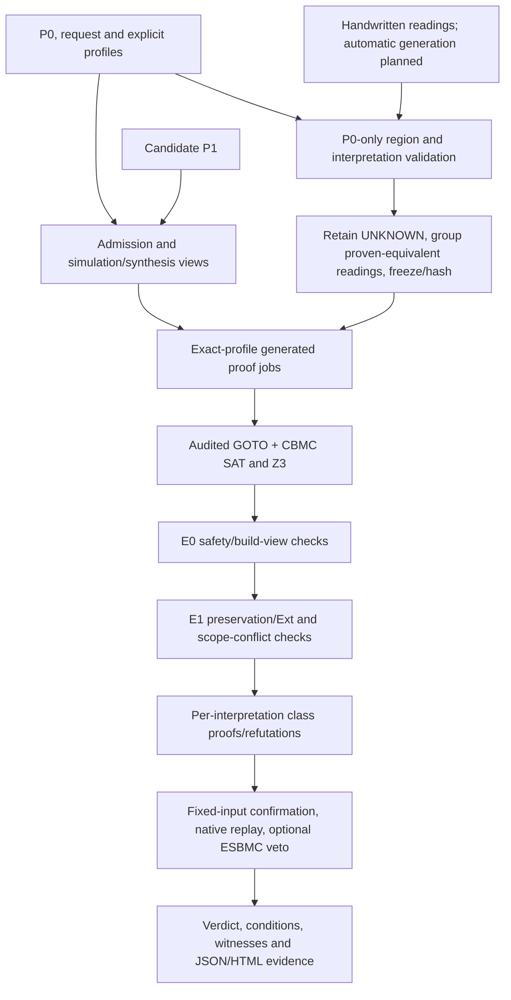

# Understanding Verdicts with Evidence: method, implementation and results

Checkpoint: T00–T11, implementation commit `8ed772e`, 23 November 2026.
This guide explains the implemented bounded checker alongside the larger design.
Preserved observations are in [the evidence checkpoint](../results/checkpoints/2026-11-23-t11/README.md).
They can be inspected without rerunning a solver.

## 1. What to read, and in what order

1. This walkthrough: the problem, concrete examples, code map and current limits.
2. The [research draft](research/Verdicts_with_Evidence_Final_Draft.md), especially
   Sections 4–7 and 9: notation, interpretation sets, verdict rules and examples.
3. The [import review](CLAUDE_IMPORT_REVIEW.md): corrections that govern the code.
   The draft is a design document, not an implementation-completion certificate.
4. [The demo guide](DEMO_GUIDE.md), then the preserved reports: connect the idea
   to the executable examples.
5. `vwe/pipeline.py` and `vwe/verdict.py`, followed by the stage modules below.

The draft's opening “No experimental result is reported” describes the draft
when written. Later implementation evidence lives separately. Do not silently
reinterpret its proposed experiments as completed measurements.

## 2. The actual question

Inputs are a buggy C function P0, an English change request N, and candidate P1.
P1 might have been written by an LLM, but the current checker does not call an
LLM at runtime. It records N but does not yet infer its meaning; the JSON
readings supply that meaning. Its task is to establish what the candidate does under explicit
input assumptions, and then decide conservatively relative to supplied readings
of N.

Pure equivalence is insufficient for a repair: the desired fix deliberately
changes some behavior. Proving only a narrow repair property is also insufficient:
“return 255 on overflow” is satisfied by a function that always returns 255.
The desired relation combines a requested change with preservation elsewhere.

Example: P0 adds two bytes and wraps. N asks for saturation. With the sum computed
in a wider type, the allowed result is:

```text
if a+b > 255:  output must be 255
otherwise:    output must equal P0(a,b), which is a+b here
```

At (250,10), the intended change is from 4 to 255. At (1,2), the result must remain 3.
A correct repair is therefore not equivalent to P0 everywhere, but an arbitrary
change away from the bug is not justified either.

### Offline, saved results and autonomy are different things

- Opening `runs/demo/index.html` shows the last saved results; it runs no tools.
- Running `make demo` computes fresh results using installed local compilers,
  CBMC SAT/Z3, native sanitizers and the available confirmation tools. It needs
  no network or LLM provider and asks no interactive questions.
- The expected verdicts are a regression oracle checked after real verification;
  they are not inputs to `vwe.pipeline.verify`'s decision rules.
- The current task still contains supplied interpretation JSON. For a new English
  request, constructing that JSON automatically is the missing T12–T13 stage.
- Full automation means the system derives readings and verifies them without
  a human in the runtime loop. It can still return UNDECIDED. Automation is not
  a promise that every input receives ACCEPT or REJECT.

## 3. Input profiles, shapes and observations

A shape states exactly how much memory a pointer refers to: for example a has n
elements, idx has one element, and the regions are disjoint. The caller profile
also states integer bounds and initial-value assumptions. The standard examples
use K=4 for size bounds; the demo uses separate K=2 copies. K does not mean
“test four inputs”: symbolic values range over the declared types/value bounds.

The harness allocates exactly `malloc(n*sizeof(T))`, not a K-element array with
only n positions initialized. The latter could hide an invalid `a[n]` read.
Two program copies receive separate buffers with identical initial contents.
Functions/globals are renamed so the two executions do not interfere.

The observation includes the return value, final buffer contents and modeled
mutable globals; supported composite values are compared field by field. An
unchanged return value alone does not establish preservation.

All claims are about the admitted, initialized, disjoint bounded C profile and
the modeled checks. Unsupported features and incomplete proofs lead to abstention.

## 4. Interpretations: the bridge from English to logic

A reading I contains:

- **Shape:** the input memory assumptions.
- **Clauses `(zone, behavior)`:** a predicate on initial inputs and the relation
  required of outputs whenever that predicate holds.
- **Ext:** the requested behavior expressed more broadly, or `unknown`.
- **Reach:** an input-only proposal for the largest affected scope.
- Provenance and an English rendering.

For saturation, a clause can be `a+b > 255 -> out_ret == 255`, with
`Ext = out_ret == min(a+b,255)`. The current JSON is in
`examples/tasks/ex1_saturate/interpretations/strict.json`.

Inside a reading's clause zone, all active clauses apply simultaneously. Outside
that zone, preservation of defined old behavior applies. If the old program has
UB, its nonexistent output cannot be treated as a trustworthy reference. Old
outputs are used only where the required safety/determinism premises hold.

The change-zone bracket is B_min = intersection of clause zones and B_max = union
of clause zones plus the supplied reach scopes. B_min is where every reading
requires a change. Outside B_max, none of the supplied scopes proposes one.
Between them, scope is uncertain. Ext is an additional guard against rejecting a
legitimate fix merely because every clause zone was drawn too narrowly.

The complete design considers shape brackets too. The implementation currently
checks one exact caller profile. It discards a too-small shape only after a
conclusive validation failure; multiple distinct surviving profiles cause
UNDECIDED. It does not implement unrestricted proof transfer across shapes.

## 5. Why a set of readings helps, and what it does not guarantee

Let Allowed_k(x) be the outputs admitted by reading k on input x, including its
preservation rule. Let Intent(x) be the outputs the user really intended.

A **sound** reading is sufficiently restrictive: Allowed_k(x) is a subset of
Intent(x), on the relevant obligation domain. If a candidate satisfies that
reading, it satisfies the intent there.

A **complete** reading is sufficiently permissive: Intent(x) is a subset of
Allowed_k(x). If a candidate violates even that permissive reading, it cannot
satisfy the intent at that witness.

Acceptance checks every surviving reading, so one sound reading can protect the
acceptance conclusion. E2 rejection refutes every reading, so one complete
reading can protect the rejection conclusion. The necessary profile/domain and
trusted-tool assumptions still apply. Individual readings can have different
refutation inputs; a single input that refutes every reading is not required.

This is not majority voting and the evidence classes are not probability scores.
Agreement among many LLM outputs does not establish that any reading is adequate.
Correlated collapse can make every reading wrong. Strict/permissive/adversarial
prompts and multiple provider families are proposed mitigations to evaluate;
the automatic generation and its statistical evaluation remain future work.

Deleting a reading can create new decisions. Therefore an interpretation is
removed only after objective invalidity evidence; UNKNOWN is retained and blocks
universal E2 conclusions. Adding readings can turn an existing E2 decision into
UNDECIDED. Repetition/union stability is the planned T14 work.

## 6. The implemented pipeline



The diagram summarizes dependencies. Actual orchestration can stop early on E0
or E1; a native pre-pass can supply hints before the main jobs. The P0-only
validation functions do not receive P1. No LLM receives P1 or P1-derived state.

### Admission and the two build views

The frontend checks signatures, supported types, calls, globals and forbidden
constructs. It builds simulation and synthesis views independently. A candidate
that changes its behavior under `__SYNTHESIS__` cannot silently pass as the same
verified program. Unqualified syntax, models or interfaces produce an explicit
unsupported/inconclusive result.

An admission-policy refusal is reported with `claim_target=admission_policy`.
It is not automatically a semantic proof that the requested repair is wrong.
A build-view counterexample has the separate `build_view_consistency` target.

### Reference-region certification

The checker first establishes where P0 is safe and deterministic. A witness of UB
inside predicate B plus safety outside B proves at most an overapproximation;
it does not prove every point in B is UB.

Exactness requires additional universal evidence. Supported certificates include
an unconditional initial buffer read and a restricted first plain store. The
copy fixture writes the last requested element first, allowing a P0-only first-
store certificate. Conditional stores, side-effecting indices and calls in the
store do not qualify. General arbitrary-loop UB-region inference is not done.
Uninitialized reads are treated as safety issues, not benign C nondeterminism.

### Interpretation validation and freezing

- **V-G:** parse/type contracts and check the emitted observers for UB.
- **V-1:** prove the caller and clause regions are reachable; a total request may
  legitimately have an empty keep region.
- **V-2:** establish that P0 has a relevant bug/change witness. Empty-zone T5
  identity/optimization readings are exempt from a repair-bug requirement.
- **V-3:** prove that old behavior is safe/deterministic wherever it is used.
- **V-4:** establish per-input realizability, not merely one satisfying example.
  The supported constructive method proposes an output tuple y=f(x), then proves
  every active clause for every modeled x. A disjunction can choose a witness
  branch, but the entire original relation must still be proved.
- **V-5:** sampled plausibility is informational, not a reason to discard a reading.

Proven equivalent readings can share a class proof. Their original members,
Ext and reach information remain available. The surviving set is frozen and
hashed before the candidate proof depends on it.

### Native hints and formal jobs

Boundary and seeded random inputs can find sanitizer failures or output changes.
Sampling has both a count ceiling and a time budget; a configured maximum of
10,000 is not a claim that 10,000 inputs ran. Sampling never proves ACCEPT.

For a formal obligation, generated C is a symbolic harness. Conceptually it asks:

```text
Does an input exist that satisfies this exact profile
and violates the monitored safety/preservation/contract property?
```

CBMC translates the bounded program and assertion into solver constraints.
A satisfying counterexample supplies a failing execution. A proof of absence of
such a counterexample supports the bounded property only after all prerequisites,
standard checks, unwinding checks and reachability/probe requirements pass.
Each obligation is PROVED, VIOLATED or INCONCLUSIVE; those are not yet final
ACCEPT/REJECT verdicts.

Both SAT and Z3 check the same audited GOTO program. Required property inventories
and labels are checked; failures in the contract, harness or unwinding cannot
silently count as a passing candidate proof. SAT/Z3 agreement still shares a
frontend and is not an independent proof of frontend correctness.

### Preventing vacuous proofs

If a candidate calls abort on difficult inputs, the default library model can
remove exactly the paths on which the repair property would fail. An apparently
successful assertion can then be vacuous. The implementation removes existing
path-cut bodies, inserts assert-false/assume-false traps, and audits the linked
GOTO instructions. Mandatory post-call reachability probes must fire, unless a
separate call-free proof certifies the relevant region empty. Unwinding failures
and timeouts stay inconclusive. Required solver flags are never disabled to make
a case pass.

### Confirmation and reporting

A semantic REJECT is reproduced with all active recorded input slots fixed in
SAT/Z3 and with isolated ASan/UBSan native drivers. A discrepancy or unavailable
required replay gives UNDECIDED. If an E2 witness does not require defined P0
output, the documented P0-UB exception is recorded explicitly rather than claimed
as a successful native replay.

ACCEPT additionally runs executable contract observers on sampled inputs when
available. An observed disagreement vetoes acceptance. ESBMC is confirmation-
only: disagreement can veto an ACCEPT, and ESBMC cannot manufacture one. On this
Mac the recorded runs use the CBMC frontend with SAT/Z3; ESBMC is unavailable and
is reported as such. Optional unavailable testing is not fabricated evidence.

## 7. The decision rules, in order

| Evidence | Condition | Final result |
|---|---|---|
| E0 | Candidate safety failure on a certified old-safe input; or separately typed policy/build-view evidence | REJECT for the reported claim target |
| E1 | Change outside B_max, P0 defined there, all Ext known, every Ext rejects that change | REJECT E1 |
| Scope check | A change outside a clause zone is permitted by Ext, so the narrow scope conflicts with the broader reading | UNDECIDED |
| E2 | Every validated interpretation class is proved | ACCEPT E2, conditional on adequate intent/profile assumptions |
| E2 | Every class is conclusively refuted and deciding witnesses confirmed | REJECT E2, with the corresponding conditional |
| Mixed or unresolved | Some classes pass and some fail; or any required premise remains unknown | UNDECIDED |

Ext does not simply overwrite each reading's preservation semantics. The scope
check prevents a narrow reading from incorrectly driving an E2 rejection of a
larger repair. E1 is also conditional on the scope/Ext adequacy premises described
in the draft and import review. E0/E1/E2 describe the kind of evidence, not
measured confidence percentages.

Repair correctness and synthesis readiness are separate claims. Current reports
leave global `synthesis_ready` inconclusive. A source-level repair ACCEPT is not
an RTL equivalence or area/latency result.

## 8. The examples and their actual observations

| Example | Candidate behavior | Observed outcome |
|---|---|---|
| 1 | Widen-and-saturate; carry-based saturation | ACCEPT E2 for both |
| 1 | Always 255 | REJECT E1 |
| 1 | Unchanged wrap; 254 on overflow | REJECT E2 for both |
| 2 | Correct empty-array handling | ACCEPT E2 |
| 2 | Fixes empty input but chooses the last tied maximum | REJECT E1 |
| 2 | Reads a[n] | REJECT E0 plus native overflow replay |
| 3 | Complete half-away-from-zero rounding | UNDECIDED, scope disagreement |
| 3 | Fixes negative odd sums only | Conditional ACCEPT E2 under deliberately collapsed readings |
| 3 | Unchanged truncation | REJECT E2 |
| 4 | Includes the last element | ACCEPT E2 on the bounded value profile |
| 4 | Reads one element beyond n | REJECT E0 |
| 5 | Saturation; reserved -1 error result | UNDECIDED for both, because valid readings disagree |
| 5 | Unchanged unsigned wrapping | REJECT E2 |
| 6 | Bounded copy | ACCEPT E2 |
| 6 | One-element truncation of ordinary copies | REJECT E1 |
| 7 | Synthesis-only behavior change | REJECT E0 for build-view consistency |
| 7 | Pure equivalent rearrangement | ACCEPT E2 |

These are 20 authored candidate fixtures across seven tasks: 7 ACCEPT, 10 REJECT,
3 UNDECIDED. All 20 matched expectations derived before execution. This is a
regression result, not a measured 100% correctness rate on unseen repairs.
The full suite records 325 passed and one local ESBMC skip. The demo's eight
candidate cases plus one abort-defence comparison all match, in 61.2 seconds;
its slowest case takes 32.1 seconds. These are observed local timings, not a
portable performance guarantee.

Two examples deserve particular attention:

**Rounding collapse:** for inputs (1,2), P0 returns 1 and the complete fix returns
2. Both supplied clause zones only cover negative odd sums, but Ext states the
full rounding rule. The complete fix must therefore abstain on scope conflict.
The negative-only fix satisfies both incomplete readings and gets conditional
ACCEPT even though it misses the English request on positive sums. That is the
known interpretation-adequacy limitation, deliberately exposed by the fixture.

**Overflow ambiguity:** saturation passes strict/permissive readings, while an
error result passes permissive/adversarial readings. Neither passes all three.
Restricting the set to strict alone changes the outcomes to ACCEPT for saturation
and REJECT for the error candidate; the tests demonstrate this dependence.

## 9. Code map and the most useful reading path

| Code | Responsibility |
|---|---|
| `vwe/tasks.py` | Immutable task loading; excludes evaluation oracles from pipeline input |
| `vwe/cli.py` | `verify`/`verify-all`; automatic interpretation commands remain unconfigured |
| `vwe/admission.py`, `vwe/c_frontend.py`, `vwe/views.py` | Structural admission, signatures, renaming and two build views |
| `vwe/contract/` | Restricted AST/grammar, typing, Python evaluation and C observer emission |
| `vwe/harness/profile.py`, `layout.py`, `adapter.py` | Exact caller profile, observations and isolated program adapters |
| `vwe/harness/generate.py` | Safety, preservation, class, scope, reference and validation harnesses |
| `vwe/regions.py` | P0-only reference-region certificates |
| `vwe/validate.py`, `vwe/harness/constructive.py` | Objective validation, constructive realizability, grouping and freezing |
| `vwe/tools/goto.py` | Linked-GOTO instrumentation and audited path-cut replacement |
| `vwe/tools/cbmc.py`, `vwe/proof_jobs.py`, `vwe/obligations.py` | Tool execution, required flags, result inventories and three-valued obligations |
| `vwe/replay.py`, `vwe/harness/native.py`, `vwe/tools/native.py` | Concrete sampling, fixed-slot replay and isolated sanitizer execution |
| `vwe/tools/esbmc.py` | Qualified optional confirmation/veto |
| `vwe/verdict.py` | Pure final decision aggregation and claim targets |
| `vwe/pipeline.py`, `vwe/report.py` | Orchestration, prerequisites, discrepancies, manifests and reports |
| `scripts/run_golden_examples.py`, `scripts/demo.py` | Twenty-case regression runner and offline presentation |
| `scripts/archive_results.py` | Package existing evidence without running verification |

For one complete trace, read `examples/tasks/ex1_saturate/task.json`, then its
P0/request/candidate/interpretation files, the corresponding preserved report,
`pipeline.verify`, and finally `verdict.decide`. Open the report's obligations
before reading the lower-level harness generator. For a difficult case, repeat
with Example 3 to see the scope veto and Example 2 v3 to see fixed-input replay.

The `eval/` functions are evaluation oracles, not inputs to the checker. Current
regression expectations are deliberately hand-derived; benchmark ground-truth
labeling and independent evaluation remain T15–T18 work.

## 10. What is finished, what can be deferred

There are 23 task cards, numbered T00–T22. T00–T11 provide the working bounded
checker and offline demo. T11 is already done, so no remaining task is needed
just to demonstrate the present handwritten-interpretation tool.

| Remaining work | Needed for the current demo? | Needed for which additional claim? |
|---|---|---|
| T12–T13 provider client and interpretation generation | No | Fully automatic request-to-verdict operation |
| T14 repetition/stability | No | Stability and repeated-generation evaluation |
| T15–T18 datasets, candidates, labels, baselines and metrics | No | Empirical claims about quality/coverage on real benchmark repairs |
| T19–T20 pragma obligations and Vitis QoR | No | Full HLS gate and measured hardware area/timing/latency improvements |
| T21 FIFO temporal extension | No | FIFO/controller trace correctness; optional separate track |
| T22 final consolidation | A short write-up is recommended | Final report and reproducible research presentation |

A practical reduced submission can present T00–T11 honestly, include a clear
write-up, and defer FIFO/repetition/full HLS integration. A stronger next increment
adds T12–T13 and a small independently labeled pilot evaluation. Claiming HLS QoR
improvement still requires actual synthesis measurements; claiming automatic
formalization still requires the generation components. The full large evaluation
is an enhancement beyond a working demo, not something the twenty golden fixtures
already establish.

## 11. Known boundaries to remember in future conversations

- Handwritten readings today; no live LLM client or `--auto` implementation yet.
- Exact, bounded, initialized/disjoint profiles; multiple surviving shapes abstain.
- Narrow UB certificates; general exact UB/defined-nondeterminism inference is open.
- Solver/model/frontend trust and interpretation adequacy remain premises.
- Optional ESBMC availability is recorded; it is not pretended on macOS.
- No measured benchmark accuracy, risk–coverage curves, Vitis QoR or FIFO proof yet.
- The shape-transfer/domain theorem concern in the import review is not resolved
  merely by passing examples. Current code stays profile-local.
- Archived run manifests record execution-time parent commits because testing
  preceded commits. The evidence index explains that provenance explicitly.
