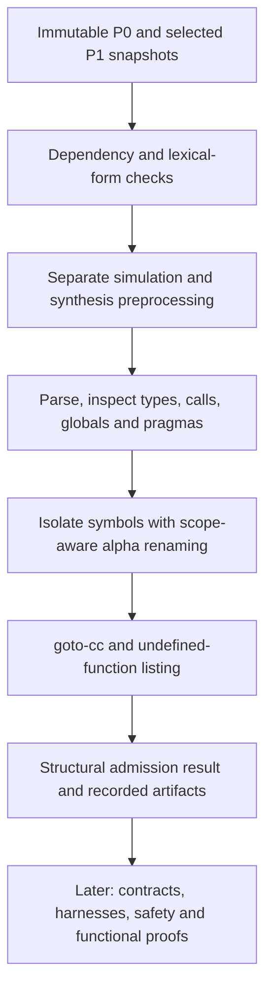

# T02 — Admission and analysis build views

Implemented on 22 November 2026. This stage answers whether the current frontend can represent a task and records the obligations that remain. **`ok` means structural admission; it is not ACCEPT, repair correctness, synthesis readiness, or build-view equivalence.**

## Running the stage

```bash
make admission
```

This runs the correct candidate from Examples 1, 2 and 4 through the installed frontend and stores results under a fresh `runs/admission/<id>/` directory. The general `vwe verify` command remains T08.

The programmatic interface uses the evaluation-isolated T01 loader:

```python
from vwe.tasks import load_pipeline_view
from vwe.admission import admit

task = load_pipeline_view('examples/tasks/ex2_argmax')
result = admit(task, 'v1')
print(result.status, result.decision, result.artifact_dir)
# ok, ok, runs/.../admission
# result.verdict is None: no correctness verdict was established.
```

`admit(task, candidate, cfg=None, out_dir=None)` accepts a candidate ID or a `Candidate` snapshot. Explicit `out_dir` is useful in tests; default paths include a fresh run ID. The source snapshot's UTF-8 hash is checked before compilation.

## Components and artifacts



| Module | Responsibility |
|---|---|
| `vwe/tools/frontend.py` | Argument-vector subprocess calls with deadlines, raw logs, structured launch/timeout errors; preprocessing and GOTO listings. |
| `vwe/c_frontend.py` | C parsing, supported type keys, call graph, declarations, global classification, HLS pragma records and scope-aware symbol isolation. |
| `vwe/views.py` | Independent macro environments and source snapshots; original/preprocessed/renamed C hashes and view manifests. |
| `vwe/admission.py` | Stage orchestration, interface/global checks, library-model requirements and admission report. |
| `vwe/verdict.py` | The policy/refusal mapping; admission code does not invent a semantic correctness verdict. |

Each program has independent `sim` and `synth` directories with `unit.c`, `preprocessed.c`, `renamed.c`, preprocessing command records and GOTO artifacts. `views.json` records actual source hashes, symbol maps, preprocessing provider and a textual difference flag. `admission.json` records per-program/view globals and pragmas, findings, tool commands and remaining checks. Runtime paths are not formalizer prompt fields.

`views_differ` compares the canonical, unrenamed C representation. It detects a possible semantic difference without being a proof: parameter spelling or harmless rewrites can also change text. Functional build-view equivalence is a later harness obligation.

## Confirmed frontend behavior

Local probes use CBMC/goto tools 6.11.0 and pycparser 3.0. Raw evidence is in [frontend-capabilities.json](../results/t02/frontend-capabilities.json).

- `cbmc --preprocess --verbosity 0` produces C without the ordinary CBMC banner. The actual preprocessing wrapper also keeps the project's BASE_FLAGS and selects C11.
- The concatenated `-U__SYNTHESIS__` spelling is rejected by this pinned binary. Each isolated wrapper therefore explicitly clears the macro, then defines it for synthesis analysis only. Actual Vitis synthesis must define its own macro.
- `goto-instrument --list-undefined-functions --verbosity 0` includes internal `__CPROVER_...` helper declarations. They are not missing user callees. Candidate-origin verifier identifiers are independently refused, and reachable ordinary calls still need bodies or an audited library model.

Official references: [CBMC 6.11.0 manual](https://github.com/diffblue/cbmc/blob/cbmc-6.11.0/doc/man/cbmc.1), [goto-instrument manual](https://github.com/diffblue/cbmc/blob/cbmc-6.11.0/doc/man/goto-instrument.1), [pycparser source](https://github.com/eliben/pycparser/blob/release_v3.00/README.rst). These links support tool interfaces; the local JSON records the narrower behaviors actually observed.

## Admission policy

| Result | Interpretation |
|---|---|
| `ok` | Supported structural checks passed; no repair verdict is returned. |
| `refused` | Candidate violates admission policy; REJECT E0 with `claim_target=admission_policy`. It does not prove failure to implement N. |
| `unsupported` | P0 or a required C/dependency feature cannot be modeled by this frontend; UNDECIDED. |
| `interface_change` | Function/global interface differs or depends on build mode; UNDECIDED. |
| `inconclusive` | A required tool step, qualified preprocessing path or snapshot-integrity check is incomplete; UNDECIDED. |

P1 verifier identifiers, assumption/unreachable calls, forbidden persistent local state, recursion reachable from the entry, heap use, volatile access, goto and declarations inside switch scopes are refused. Missing user bodies are policy refusals for P1 and unsupported for P0. Unsupported type features, including floating point, atomic types, local variable-length arrays and unqualified casts, abstain. Existing observable global removal/type changes abstain; additional P1 file-scope storage is refused.

Global reads/writes are collected through reachable function bodies with local shadowing respected. Constant aliases/arrays are classified as `const_program`; mutable objects as `input_output`. Global pointer-bearing storage currently needs a separate alias model and is unsupported. Global initialization/reset and complete state comparison remain harness responsibilities.

The first dependency profile permits direct standard-header names only. It refuses local/absolute/computed includes, alternative directive spellings requiring unimplemented handling, environment/function-name introspection and non-HLS preprocessing pragmas. This prevents a task from silently pulling in `eval/` or unrelated source files. It is a closed frontend profile, not an operating-system sandbox. System headers/toolchain paths remain part of the trusted environment. A permitted header can still contain syntax pycparser cannot represent, in which case admission abstains.

GCC fallback preprocessing is saved as `gcc-fallback-unqualified`; it cannot silently pass admission. No `__attribute__`, packed layout or other unsupported syntax is stripped to make parsing succeed. The fallback can be qualified later with its own explicit frontend profile.

## Symbol isolation and library calls

A global symbol map isolates the entry, helper definitions and global objects. The rewriter preserves string/character literals, struct members/designators, parameter names and local/for-loop shadowing. It handles block extern declarations and local prototypes and refuses a generated-name collision. Function-name introspection is unsupported because renaming would change `__func__`/`__FUNCTION__`. Native original-versus-renamed tests check return values and global state on a small deterministic domain; this is regression evidence, not a universal proof of compiler correctness.

`config/whitelist.toml` contains LP64 prototypes for `memcpy`, `memset`, `abs` and `labs`. Matching names alone are insufficient: the declaration's supported type key must match. The result records `required_library_models`; T05 must link and qualify those models before using any proof. Declared but unused standard-header functions do not become spurious missing-body refusals.

HLS pragmas are recorded with location, ordered arguments and options for each source/view. Unknown HLS names are recorded too. **Pragma policy, DEPENDENCE-false checks, hardware readiness and synthesis are NOT_RUN at T02.**

## Tests and plan adjustments

```bash
pytest -q tests/test_admission.py tests/test_views.py tests/test_frontend_tools.py
make test
make admission
make golden
```

Pure unit tests mock frontend commands and need no verifier. Installed-tool cases use the repository's CBMC-availability skip guard and an integration marker. Tests cover the required three examples, actual macro-controlled build views and missing bodies; timeout/malformed-list handling; signature and type aliases; global state; dangerous identifiers, dependency paths and lexical forms; scope-aware renaming and native preservation; library signatures; fallback qualification and artifact hashes.

Two T02 card suggestions are deliberately strengthened: token-wide regex renaming is replaced by AST/scope-aware renaming, and erasing GCC attributes is replaced by abstention. These choices preserve source semantics and are consistent with the import review. They introduce no human runtime step.

Remaining work is explicit: T03 contract parsing/type checking, T04 proof harnesses/observations, full T05 linked-program defenses and confirmation, T07 interpretation validation, T08 orchestration, and T19 pragma policy. T02 does not implement any of those proofs.
