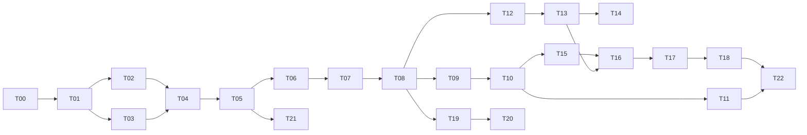

# Implementation plan

## Goal

The goal is a **working tool plus evidence that it works**, as the professor asked. Concretely, by the end:

1. **`vwe verify`** runs on any supported `(P0, N, P1)` triple and prints a verdict, an evidence class, a witness and an HTML report.
2. **`make demo`** shows the method on the showcase examples in a few minutes, offline.
3. **A small but real evaluation** on about 20 benchmark tasks and about 200 candidate fixes, compared against simple baselines, with risk–coverage results.
4. **Optional extensions:** the HLS gate (pragma policy plus QoR on a machine with Vitis HLS) and the FIFO temporal track.

## Phases and milestones

| Phase | Tasks | Result | Milestone (week) |
|---|---|---|---|
| 0 Foundations | T00 | Makefile, CI, packaging, config | week 1 |
| 1 Core engine (hand-written interpretations) | T01–T10 | full pipeline from interpretation JSON to verdict and report; golden tests for draft Examples 1–7 | **M1: working tool**, week 4 |
| 2 Demo | T11 | `make demo` + demo guide for the professor | **M2: demo**, week 5 |
| 3 LLM automation | T12–T14 | interpretations generated automatically (≥ 2 model families), cached, reproducible | **M3: fully automatic**, week 6 |
| 4 Evaluation | T15–T18 | benchmark tasks, candidate pools, labels, baselines, metrics and plots | **M4: results**, week 8 |
| 5 Extensions | T19–T21 | pragma policy + Gate B; Vitis QoR; FIFO track | week 9 (stretch) |
| 6 Wrap-up | T22 | documentation, final report figures and tables | week 10 |

**Priority if time is short:** T00–T11 are **must-have**. T12–T13 and T15–T18 are **should-have**. T14 and T19–T21 are **nice-to-have**. Even with only Phases 0–2, the professor gets a working, demonstrable tool.

## Dependency graph

## What "working" means for each milestone (checked by commands)

- **M1:** `make test` green. `make golden` shows all Examples 1–7 matching `tests/golden/expected.json`. `vwe verify examples/tasks/ex2_argmax --candidate v2` prints `REJECT E1` with witness `n=...` and writes `report.html`.
- **M2:** `make demo` finishes in under 5 minutes on a laptop without network access and shows a coloured verdict table plus an `index.html`.
- **M3:** `vwe interpret examples/tasks/ex1_saturate` produces a validated, hashed interpretation set from at least two model families. `vwe verify --auto` reproduces the M1 verdicts on Examples 1, 2 and 4, or the differences are explained in `plan/OPEN_QUESTIONS.md`.
- **M4:** `make eval` produces `results/eval/summary.md` with risk–coverage plots, Wilson intervals and baseline comparisons.

## Task list

| ID | Title | Priority | Depends on |
|---|---|---|---|
| T00 | Foundations: Makefile, CI, packaging, config | must | — |
| T01 | Task format, example task folders, loader with `eval_only` isolation | must | T00 |
| T02 | Admission and build views | must | T01 |
| T03 | Contract expression language (parser, type checker, C emitter) | must | T01 |
| T04 | Harness generator | must | T02, T03 |
| T05 | Tool pipeline: path-cut defences, CBMC backends, ESBMC confirmation, outcome classification | must | T04 |
| T06 | Computed regions $B_{ub}$, $B_{nd}$ | must | T05 |
| T07 | Interpretation validation, equivalence classes, freezing and hashing | must | T06 |
| T08 | Orchestrator, CLI `vwe verify`, JSON and HTML reports | must | T07 |
| T09 | Native pre-pass and witness replay (GCC sanitizers) | must | T08 |
| T10 | Golden suite for draft Examples 1–7 | must | T09 |
| T11 | Professor demo (`make demo`) and demo guide | must | T10 |
| T12 | LLM client: provider-neutral, cached, schema-enforced, isolation-tested | should | T08 |
| T13 | Interpretation generation prompts (typing, shapes, strict/permissive/adversarial) | should | T12 |
| T14 | Repetition, union over runs, stability metric | nice | T13 |
| T15 | Benchmark ingestion (Chrysalis-HLS, CHStone, MachSuite, fresh tasks) | should | T10 |
| T16 | Candidate pools and ground-truth labelling | should | T15, T13 |
| T17 | Baselines (LLM judge, tests from N, implementation consensus, single contract) | should | T16 |
| T18 | Metrics, risk–coverage, statistics, results report | should | T17 |
| T19 | HLS pragma policy, DEPENDENCE obligation, Gate B (type T5) | nice | T08 |
| T20 | Vitis HLS QoR scripts (needs a machine with Vitis HLS) | nice | T19 |
| T21 | FIFO temporal track | nice | T05 |
| T22 | Wrap-up: docs, figures, final report material | must | T11, T18 |

## Risks to watch (from the verified review)

- **Solver time on large relational harnesses.** Keep $K$ small (4–8), stop early on E0/E1, and deduplicate equivalence classes.
- **`P0` with widespread undefined behaviour.** These tasks give UNDECIDED (reference unusable). This is correct behaviour; do not "fix" it.
- **LLM collapse onto one reading.** It is measured in Phase 4 and cannot be engineered away.
- **Vitis HLS CLI for 2026.1 is not verified.** T20 starts by verifying it.
